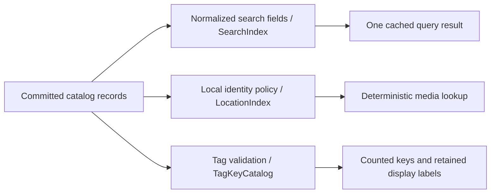
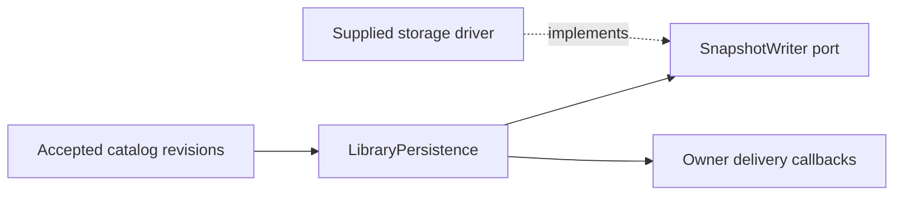

# Catalog application workflows

These workflows and indices own application state; the catalog remains authoritative. They use ordinary C++ values and have no Qt event-loop or storage dependency.

Search matching uses the catalog predicate rather than a second implementation. A query result is borrowed until the next query or index mutation; field pointers are borrowed until that entry changes or the index is cleared. A rebuild invalidates its old cache label before doing work that can fail.

Location updates allocate only new membership/reverse-ownership nodes, retaining existing shared owner buckets. Tag-key updates prepare only affected counters/labels and reverse ownership. Native conversion and allocation complete before live state changes; standard map/set node transfer then commits without allocation. Shared ownership, labels and revision transitions remain consistent after rejected preparation. Unchanged membership does not rebuild live buckets. Shared paths select the smallest media identity deterministically.

`local_identity.hpp/cpp` owns historical local path-to-ID compatibility. It is separate from opaque catalog identity and provider resource identity. `artwork_store.hpp/cpp` owns bounded artwork observations; image presentation remains in the frontend. Focused behavior and allocation-failure cases have separate search, location and tag-key test files/executables under [application tests](../tests/README.md), sharing one local owned-record fixture.

`library_persistence.hpp/cpp` owns bounded accepted revisions, the snapshot-writing worker, retries, durability receipts and shutdown. Its `SnapshotWriter` port owns no encoding or Qt types. A supplied delivery adapter posts owner-thread callbacks and drains them during explicit flush/stop. The writer and delivery receiver outlive the workflow. The [Qt storage driver](../../qt/storage/README.md) implements snapshot writing; the Qt application layer composes it with its queued receiver.

`WIOLA_COMPONENTS=library_persistence` configures only persistence, catalog, media values and quantities. Clients link `wiola::library_persistence`; headers use `<wiola/app/library/...>` while authored files stay beside their implementation. The port alone is `wiola::snapshot_writer`. Portable tests supply a controlled writer and manual owner delivery without a Qt event loop or a filesystem.

Persistence state stays private to its implementation. Active operations retain that state; the worker retains it until join, and scheduled owner callbacks hold weak references. Disposing the workflow disables notifications, joins the final admitted write and cancels pending and active receipts without pumping a closed receiver. A flush that loses its owner reports the final write outcome. Acknowledgment releases logical receipt capacity before callbacks run, while active receipts remain owned so disposal can cancel them. Callback failures do not strand other eligible acknowledgments; delivery rethrows the first failure after finishing the batch.

Admission counts retained container and text capacity against the applicable normal or file-result byte budget before allocating a receipt. Each addition is bounded by the remaining budget, so oversized counts reject without overflowing arithmetic or consuming a revision. This budget is deliberately conservative; it does not claim to measure allocator overhead or process memory.

A pending delta retains its byte capacity until all of its records and removals have reached the worker-owned snapshot state. Failed preparation leaves that immutable delta queued; retry replays it before newer revisions. The initial snapshot is likewise retained until initialization succeeds. Failures wait for an explicit retry or newer revision instead of spinning, and shutdown joins the final attempted prefix without looping on failed preparation.

Each completed write has a private attempt identity. Queued notifications and synchronous flush/stop share that identity, so fallback delivery cannot duplicate acknowledgments or let an older result replace a newer one. Receipt and waiter outcomes follow the known durable revision prefix, including earlier saved records when the latest attempt fails. Rejected or throwing posts leave the write outcome available for explicit flush/stop. A drain or observer exception is rethrown after eligible completion delivery has been attempted; preparation failure leaves delivery retryable.
