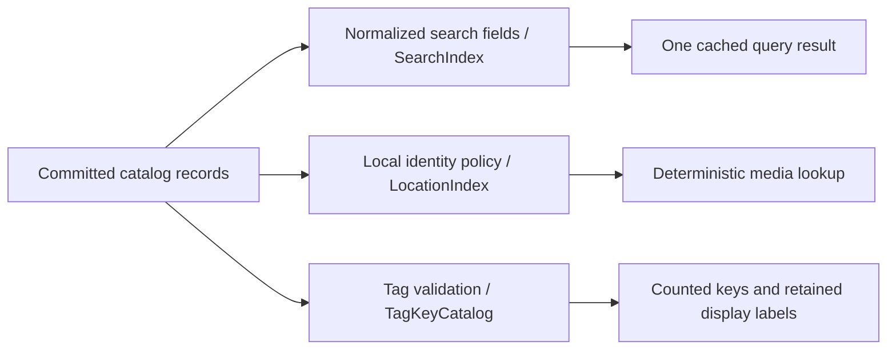

# Catalog-derived application observations

These indices own derived application state; the catalog remains authoritative. They use ordinary C++ values and have no Qt event-loop or storage dependency.

Search matching uses the catalog predicate rather than a second implementation. A query result is borrowed until the next query or index mutation; field pointers are borrowed until that entry changes or the index is cleared. A rebuild invalidates its old cache label before doing work that can fail.

Location updates allocate only new membership/reverse-ownership nodes, retaining existing shared owner buckets. Tag-key updates prepare only affected counters/labels and reverse ownership. Native conversion and allocation complete before live state changes; standard map/set node transfer then commits without allocation. Shared ownership, labels and revision transitions remain consistent after rejected preparation. Unchanged membership does not rebuild live buckets. Shared paths select the smallest media identity deterministically.

`local_identity.hpp/cpp` owns historical local path-to-ID compatibility. It is separate from opaque catalog identity and provider resource identity. `artwork_store.hpp/cpp` owns bounded artwork observations; image presentation remains in the frontend. Focused behavior and allocation-failure cases have separate search, location and tag-key test files/executables under [application tests](../tests/README.md), sharing one local owned-record fixture.
