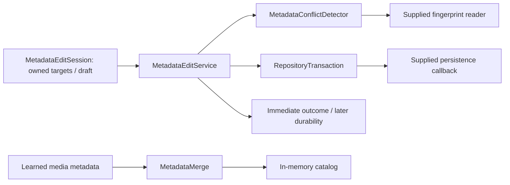

# Metadata application workflows

Catalog edit policy, captured drafts, conflict checks and learned-metadata merging live here. File-writing jobs are separate workflows; Qt delivery and window state remain in their adapters.

`wiola::metadata_edits` builds these four policy classes with catalog/media values only. `WIOLA_COMPONENTS=metadata_edits` configures their focused tests without Qt, codec/device preparation or native file access. A fingerprint reader is required when captured expectations contain a fingerprint; unavailable readers and source failures produce an unreadable conflict. Host composition selects the concrete reader.

The edit service belongs to its creating thread and has one lifetime identity. Its private state retains active operations and mutable callbacks. Notifications run after the repository transaction has finished, so an observer can start another edit. Each operation reports one immediate result; an accepted receipt may later report save failure/retry/success. Service destruction disables future notifications while admitted persistence work keeps its own lifetime.

Captured-session application owns the inputs it needs before invoking supplied code. Normal application checks the captured revisions and fingerprint; explicit overwrite chooses the same edit path without those expectations. Reset removes application overrides, while merging learned fields preserves overrides and custom catalog tags.

Focused conflict tests use an in-memory reader and record the requested location. Pure merge tests are separate from the background-reader integration. The repository must outlive an active edit transaction, including when a callback disposes the service facade. Observer failure cannot roll back an already accepted edit.

File replacement policy requires a supplied `media::FileReplacement` reference. It validates the captured source/output, constructs an owned request and preserves the driver outcome; it never constructs a native fallback. `LibrarySession` selects and owns the native driver before the write service, so the driver outlives its worker. The restart journey supplies its own fault-controlled driver through the same port.

`BackgroundMetadataWrites::run` coordinates the bounded queue and cancellation; `stage` executes one captured job. Provider/asset exceptions produce a failed I/O outcome for that job. The Qt write service applies the same exception boundary during output validation and final replacement, closes the failed operation and admits later work. This does not change on-disk metadata or recovery formats.

The staging worker owns its pending queue as a detachable allocation. Shutdown closes admission and detaches jobs under the mutex, then requests cancellation outside the mutex and joins before delivering queued terminal outcomes. Observer exceptions are retained and reported by explicit `stop()` after worker closure; later jobs remain usable until shutdown. Destruction performs the same essential cleanup without propagating observer errors. A worker callback must not join or destroy its own worker.
