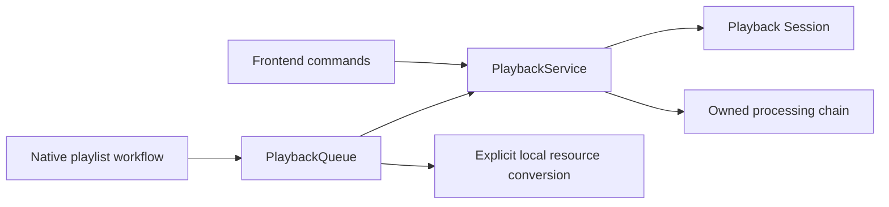

# Application playback

PlaybackService owns the portable kernel Session and the built-in equalizer/volume chain used by application commands. Playback policy and presentation stay here; widgets and native device construction belong to their adapters.

Service commands and observations use `media::ResourceReference`. The same reference reaches Session, snapshots and resource handoff without a second path cache or filename interpretation. The caller supplies the media provider and output factory. A new provider can interpret its own keys without changing this service or the kernel.

PlaybackQueue adapts the current path-based library and saved-playlist workflows into those commands. Its explicitly named path operations perform local conversion at this boundary. Saved-playlist destinations and transfers live with [catalog commands](../library/README.md); they do not own the playback queue. Frontend event delivery and persistence completion do not belong to Session.

VolumeControl and EqualizerControl own frontend control policy beside PlaybackService. They apply restored values without writing them back and send semantic writes through PlaybackSettingsWriter. The borrowed playback service and writer outlive the controls. The writer owns persistence failure behavior; a failed write does not roll back a runtime audio change that has already been applied.

PlayerSettings carries typed startup values. QtSettingsAdapter owns every volume/equalizer key and its encoding; controls contain no QString, QSettings or storage keys. Unknown equalizer band indices are ignored before either audio mutation or persistence. Gains for valid layout bands remain available even when a current stream cannot reproduce that band.

QueueSettings owns restoration and capture of the current queue. QueueSettingsStore supplies owned QueueSnapshot values; the host supplies the track availability check. Local resource conversion is explicit here, while QSettings decoding and native existence checks remain outside the policy. Repeat is an engine enum in the snapshot; integer encoding belongs to the store adapter.

Occurrence remapping preserves duplicate paths as separate queue entries. Legacy filename selection is relative to the newly appended portion of the queue. Save omits resources whose provider has no local path, and never invents a local filename for a different provider. The borrowed playback service and snapshot store must outlive the workflow; restore runs during application startup while playback still accepts queue changes.

A rejected restoration admission is counted as unrestored tracks before any occurrence mapping is built. This keeps explicit restore calls safe after playback stops accepting work. Capturing the current queue remains available for the final shutdown save.

`wiola::playback_service` builds the PlaybackService façade and volume/equalizer controls using the portable playback kernel and DSP. Configure `WIOLA_COMPONENTS=playback_service` to develop this API with supplied media/output drivers without preparing Qt, codecs or a device backend. Public includes use `<wiola/app/playback/...>`. Its ordinary target declaration lives here beside the implementation.

`wiola::playback_preferences_api` contains the typed settings writer, queue snapshot store and scale contracts. A storage adapter can link those headers and playback values without linking the playback implementation. These are ordinary CMake targets; no internal package/SDK installation is required.

An output factory is required even when it intentionally returns no device; missing configuration is rejected before playback state is created. Volume changes apply a valid runtime state before storage calls. If disabling boost fails to save, the runtime position/gain already respect the reduced travel.
