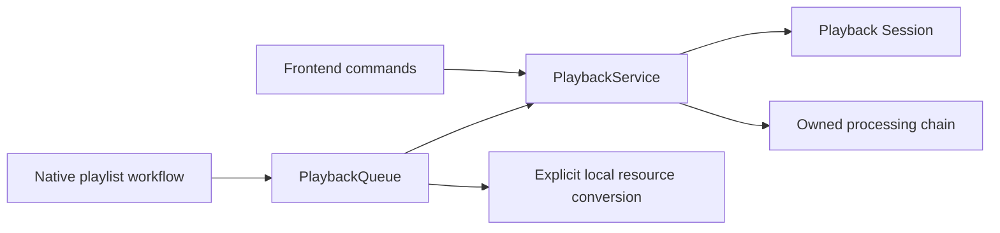

# Application playback

PlaybackService owns the portable kernel Session and the built-in equalizer/volume chain used by application commands. Playback policy and presentation stay here; widgets and native device construction belong to their adapters.

Service commands and observations use `media::ResourceReference`. The same reference reaches Session, snapshots and resource handoff without a second path cache or filename interpretation. The caller supplies the media provider and output factory. A new provider can interpret its own keys without changing this service or the kernel.

PlaybackQueue adapts the current path-based library and saved-playlist workflows into those commands. Its explicitly named path operations perform local conversion at this boundary. ActivePlaylist and playlist-transfer operations own destination/occurrence policy independently of the queue being played. Frontend event delivery and persistence completion do not belong to Session.

VolumeControl and EqualizerControl own frontend control policy beside PlaybackService. They apply restored values without writing them back and send semantic writes through PlaybackSettingsWriter. The borrowed playback service and writer outlive the controls. The writer owns persistence failure behavior; a failed write does not roll back a runtime audio change that has already been applied.

PlayerSettings carries typed startup values. QtSettingsAdapter owns every volume/equalizer key and its encoding; controls contain no QString, QSettings or storage keys. Unknown equalizer band indices are ignored before either audio mutation or persistence. Gains for valid layout bands remain available even when a current stream cannot reproduce that band.
