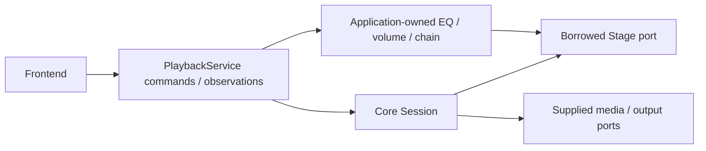

# Application playback

PlaybackService owns application playback lifetime and semantic controls. Its private implementation owns the built-in equalizer, volume, fixed ProcessingChain and the core Session using that exact Stage. Destruction tears Session/output down before processing storage. The public facade exposes values and commands, not mutable DSP objects or a raw kernel accessor.

The host supplies media and output construction; the application chooses built-in processing. A new processing feature belongs to its own implementation and application composition rather than adding methods/branches to Session. Core specialists may construct Session with an independently supplied Stage, without understanding the built-in controls.

Command acceptance during application shutdown remains owned here. Stop stays available, while new play/queue/settings mutations are rejected after stop_accepting. The service owns one processing path so callers cannot accidentally give controls one settings object and playback another. Its implementation stays hidden and the service is noncopyable/nonmovable.

PlaybackQueue and PlaylistTransfer translate explicit library selections into queue operations. ActivePlaylist holds the selected saved-playlist identity. Playback presentation produces values for a frontend; no Qt widget or output SDK belongs to this folder. File formats, device callbacks, decoder scheduling and queue storage stay behind their owning contracts.

Equalizer observations, including band centers, stay available as semantic values. Fractional seeking uses the optional duration without allocating a snapshot/path copy. Core seek owns loaded/seekability validation; an unknown duration supplies no basis for a fractional seek.
