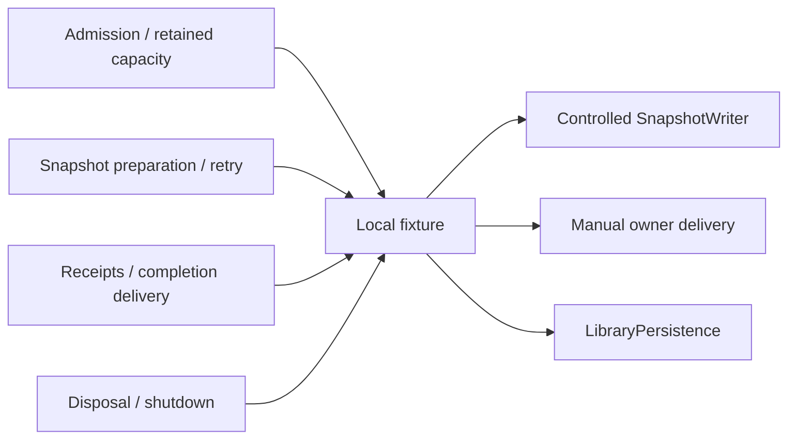

# Portable persistence tests

These cases exercise the complete persistence workflow through controlled C++ ports, without Qt, a filesystem or a media parser.

The four case files share [fixture.hpp](fixture.hpp): manual completion delivery, a blocking snapshot writer and an owned revision factory. The fixture has one named type across translation units, as required by GoogleTest. It releases a blocked writer before joining even when an assertion ends a case early.

Allocation cases use the existing standard C++ failure fixture. Owner-side scopes end before assertions and recovery. Worker preparation cases arm one failure through the controlled delivery collaborator after a seed write. TSan keeps ordinary behavior cases and supplies its own allocator.

All cases remain in `app_library_persistence_test`; CMake/CTest registration and test names are unchanged. Real Qt delivery and storage behavior stay in their adapter integration tests.
