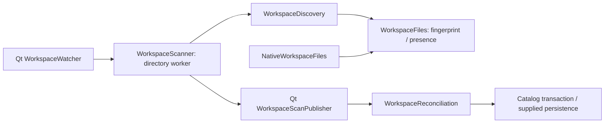

# Workspace discovery and scanning

Discovery identifies new, known and uniquely relocated media from an immutable catalog snapshot. Reconciliation applies a complete scan to the catalog transactionally. Neither policy selects a file driver or depends on Qt.

`wiola::workspace` owns discovery, reconciliation and their file-observation port. `WIOLA_COMPONENTS=workspace` builds this policy and its tests using catalog/media values and local identity normalization only. `wiola::local_identity` preserves historical path-derived identities without opening media. Both are ordinary CMake targets.

The native scanner owns its file adapter for the duration of a scan. An injected `WorkspaceFiles` must outlive discovery and receives the scan cancellation token. Unknown file presence is conservative: an inaccessible original is never treated as proof that a matching new path is its replacement. A captured enumeration supplies presence without later existence queries. Ambiguous fingerprints preserve distinct catalog identities; each identity can relocate only once per discovery snapshot.

Only complete scans are reconciled. Captured content revisions protect newer catalog changes, and persistence rejection rolls back the transaction. The persistence callback retains its mutable identity across reconciliations and outlives an admitted transaction even if that callback disposes the workflow facade. The repository must still outlive the transaction.

Native fingerprints and filesystem observations remain in `native_workspace_files.*`; batching, cancellation and directory traversal remain in `workspace_scanner.*`. Qt watching, scheduling and owner-thread delivery live together under `src/qt/application/workspace`. Pure policy tests use in-memory observations; native integration tests retain real temporary files.
