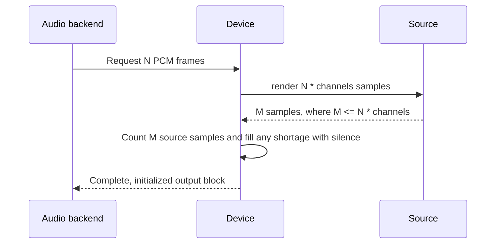
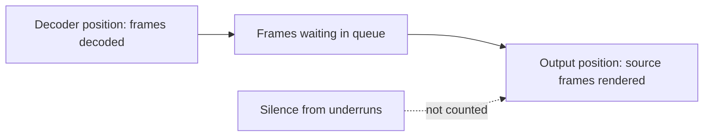
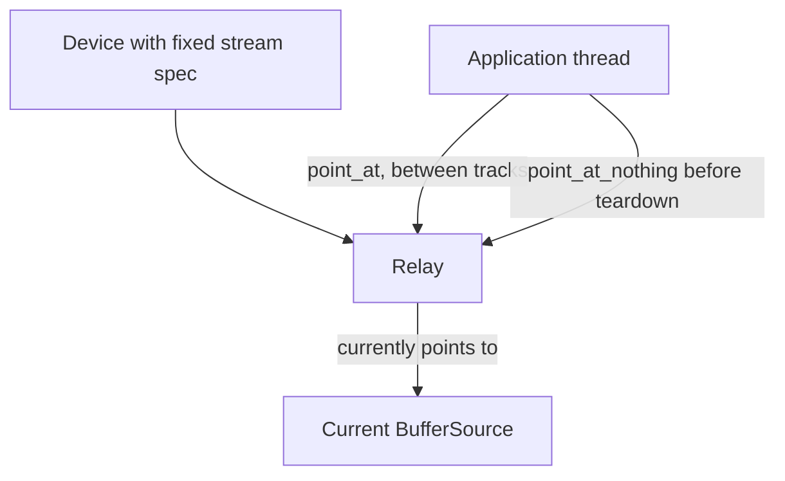
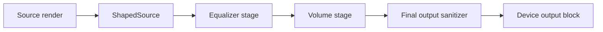
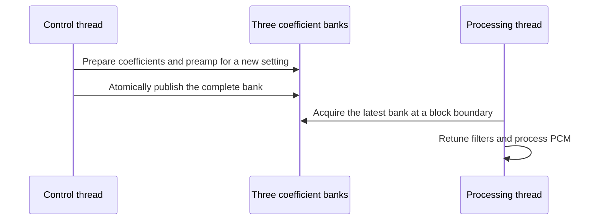
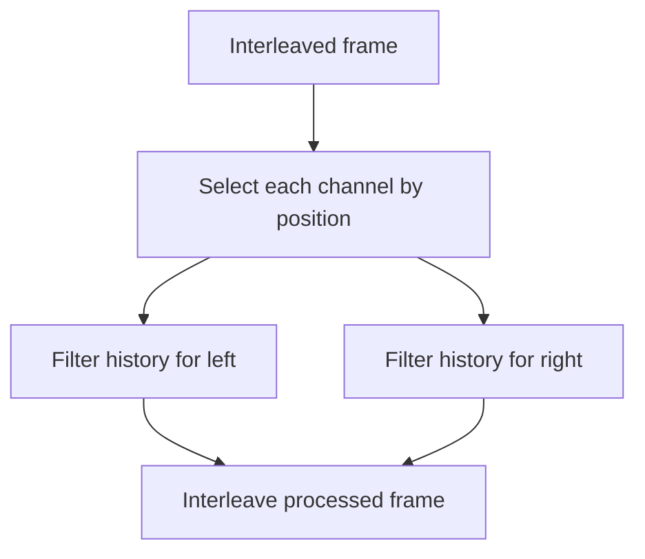
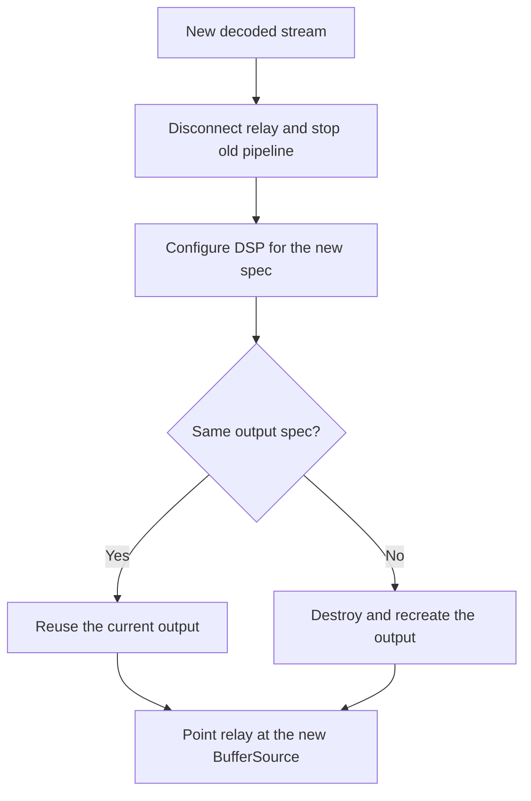

# From decoded PCM to the speakers: the audio layer

The audio layer is where decoded samples become sound. Its central rule is simple: **the device
never opens an audio file and never runs a codec**. It receives already-decoded, interleaved
floating-point PCM through a small real-time source interface.

This guide follows that PCM through buffering, source switching, equalization, volume, output
sanitizing, and the platform audio device. It also explains why some work is safe in the audio
callback and why other work must stay on application or transport threads.

For the compressed-input side, start with the [codec guide](../codec/README.md). For sample, frame,
and channel-layout theory, see the [PCM guide](../core/media/README.md).

## 1. The complete path

```mermaid
flowchart LR
    Decoder[Codec decoder on transport worker] --> Queue[Frame-aligned PCM queue]
    Queue --> Buffer[BufferSource]
    Buffer --> Relay[Relay: current track source]
    Relay --> Shaped[ShapedSource]
    Shaped --> EQ[Equalizer]
    EQ --> Volume[Volume]
    Volume --> Sanitizer[Output sanitizer]
    Sanitizer --> Device[Miniaudio Device]
    Device --> Backend[Platform audio backend]
```



The transport worker produces PCM on the left. The audio backend consumes it on the right. The
single-producer/single-consumer queue is the boundary between them.

Everything from `BufferSource` to `OutputSanitizer` runs when the device asks for more samples.
Nothing in that path should open files, wait for a decoder, allocate memory, or take a lock.

## 2. What the device does—and does not accept

[`Device`](device/device.hpp) is Wiola's default system audio output, implemented with Miniaudio.
When it starts, it reads a [`pcm::StreamSpec`](../core/media/public/wiola/media/stream_spec.hpp) from its source and configures
a playback stream with:

- 32-bit floating-point samples;
- the source's sample rate;
- the source's channel count;
- an explicit channel map for mono, stereo, or 5.1-side audio.

The platform backend owns the details of the actual hardware and driver. Wiola asks Miniaudio for
this playback format; it does not assume that every physical device uses the same format internally.

The input boundary looks like this:

| Input | Can `Device` consume it directly? | Where it is handled |
| --- | --- | --- |
| MP3, FLAC, AAC, Opus, or another compressed file | No | FFmpeg demuxing and decoding in the codec layer |
| Integer PCM or planar codec frames | No | `PcmConverter` in the codec layer |
| Interleaved float PCM at one fixed stream specification | Yes | `Source::render` and the audio layer |
| A stream that changes rate or channel layout mid-track | No | Rejected before it reaches the queue |

The device is therefore not a universal media reader. It is the final consumer of one well-defined
PCM stream.

### Channel mapping

[`Device::set_channel_map`](device/device.cpp) preserves the meaning of each position:

- mono becomes `MA_CHANNEL_MONO`;
- stereo becomes front left and front right;
- 5.1-side becomes front left, front right, center, LFE, side left, and side right.

The processing chain does not downmix six channels to two or invent surround channels from stereo.

## The codec-to-audio contract, value by value

The codec and audio layers share PCM values and a stream specification, but they deliberately do not
share one interface. The codec's read operation belongs to the blocking transport worker; the
source's render operation belongs to the real-time output path.

[`PlaybackPipeline`](../engine/pipeline/playback_pipeline.cpp) is where those worlds are connected.
It receives a `std::unique_ptr<media::AudioDecoder>`, constructs a `PcmQueue` from the decoder's stream
specification, gives the queue's producer to the transport player, and exposes the queue's consumer
as a `BufferSource`.

```mermaid
sequenceDiagram
    participant Codec as media::AudioDecoder
    participant Loop as DecodeLoop
    participant Queue as PcmQueue
    participant Source as Source and DSP chain
    participant Device as Device

    Note over Codec,Loop: Blocking transport worker
    Codec-->>Loop: DecodeOutcome with frame count and EOS
    Loop->>Queue: Frame-aligned span of float samples
    Note over Queue,Device: Real-time consumption
    Queue-->>Source: Complete-frame samples
    Source-->>Device: Rendered and processed samples
    Device-->>Loop: frames_played when position is queried
```

The boundaries pass these exact values:

| Boundary | What is passed | What it means |
| --- | --- | --- |
| Decoder to pipeline | `DecoderStreamInfo` | Sample rate, channel count/layout, optional length and accuracy, and seek capability. The device needs only the stream specification; the player uses the playback facts. |
| Decoder to `DecodeLoop` | `media::Result<DecodeOutcome>` | Whole decoded PCM frames, the number produced, explicit end-of-stream, or a typed error. A short read alone is not EOS. |
| `DecodeLoop` to `PcmQueue::Producer` | `std::span<const float>` plus accepted-sample count | Interleaved samples in a frame-aligned block. Zero accepted samples means the queue is full, so the worker waits instead of dropping audio. |
| Queue to `BufferSource` | `std::span<float>` plus returned-sample count | Complete frames already decoded. A short answer means the consumer caught up with the producer. |
| `BufferSource` through relay and DSP | The same output span and a fixed `StreamSpec` | PCM is modified in place. Frame order, sample rate, and channel meaning remain unchanged. |
| `Source` to `Device` | Rendered-sample count | How much real source material was supplied. The device fills any remainder with silence and counts only the supplied frames. |
| Device back to transport | `frames_played` | Output progress used to compute the audible position and decide when buffered final audio has drained. |

End-of-stream is intentionally **not** stored in the PCM queue or passed through `Source::render`.
The transport learns it from the codec, waits until queued audio has played out, and then finishes
playback. The audio callback sees only samples or a shortage of samples.

Output start/stop commands are also out-of-band control operations, not values embedded in the PCM
stream. Metadata, artwork, filenames, FFmpeg packet/frame objects, codec contexts, and decoder
pointers never cross into the real-time source path.

### A concrete two-channel example

Suppose the decoder produces two stereo frames:

```text
L0, R0, L1, R1
```

At the codec boundary, `DecodeOutcome` reports `frames = 2`. `DecodeLoop` uses the stream
specification to treat these as four samples and attempts to push all four into the queue. It does
not report “four frames” to the queue: the queue works in floats, while the public decoder result
works in frames.

If the audio callback later asks for two frames but only one remains in the queue, `BufferSource`
returns two samples. The device supplies two additional zero samples to complete its output block,
increments `frames_played` by one frame, and increments `num_underruns` once.

If the decoder's final result contains two frames **and** `end_of_stream = true`, those four samples
still enter the queue normally. EOS stays with the transport worker while the audio callback drains
them and any older queued audio. Only after that audible material has played out does transport
finish.

### Ownership at the boundary

The decoder remains owned by the transport pipeline. The queue belongs to `PlaybackPipeline`.
`BufferSource`, relay, and processing stages use non-owning references, so their lifetime is enforced
by output shutdown and `OutputConnection`, not by passing another smart pointer through the audio
callback.

This is why the handoff needs both a data contract and a lifetime contract: the span tells the
callback where the samples are, while stopping the output guarantees that nobody is still reading
them when their owner goes away.

## 3. The real-time source contract

[`Source`](../core/audio/public/wiola/audio/source.hpp) is the small interface the device understands. It has only two important
operations:

- `spec()` describes the PCM format, fixed for the source's lifetime;
- `render(span<float>)` fills whole frames and returns the number of samples written.

`render` is a **nonthrowing, bounded, real-time callback contract**. It must not allocate, lock,
perform file I/O, block, or destroy anything. This is different from `media::AudioDecoder::read`, which
may perform blocking container and codec work on the transport worker.

A short render means the source could not provide the whole requested block. It does not pass an
exception or an error code through the real-time path.



## 4. What happens inside the device callback

Miniaudio invokes the callback configured in [`Device::start`](device/device.cpp). The callback
converts the requested frame count to a sample count and calls [`Device::render`](device/device.cpp).

`Device::render` then:

1. asks the source for samples;
2. converts the number of returned samples back to complete frames;
3. adds those frames to `frames_played`;
4. fills any unwritten remainder with zeroes;
5. increments `num_underruns` if the source was short.

The output block is always fully initialized, even when the source has no audio ready.

### Played time is not wall-clock time

`frames_played` counts source material handed to the backend. Silence inserted because the source
was starved does not count. The playback position therefore stops instead of running ahead when the
decoder cannot keep up.

This is also different from the decoder's position: decoding normally runs ahead by the PCM still
waiting in the queue.



`num_underruns` is a diagnostic counter, not a request to seek or a measure of track duration.

## 5. Why BufferSource sits between decoding and output

[`BufferSource`](../core/playback/private/buffering/buffer_source.cpp) is a `Source` adapter over the consumer end of a
[`PcmQueue`](../core/playback/private/buffering/pcm_queue.hpp). Its `render` simply pops interleaved samples.

The transport worker is the producer; the device callback is the consumer. The queue preserves
complete frames, so a short read or write cannot rotate stereo or surround channels.

This separation lets decoding run ahead without letting the decoder or filesystem into the
real-time callback.

## 6. Relay lets one output survive track changes

A `Device` is constructed with a source, but a music player changes sources whenever the track
changes. Recreating the device every time would be unnecessary when the next track has the same
format.

[`Relay`](dsp/relay.hpp) solves this by holding an atomic pointer to the current `Source`. Its own
stream specification remains fixed. The application points it at each track's `BufferSource` in
turn; the callback follows the pointer it observes.

Pointing the relay at nothing returns zero samples. If a callback still runs after that, the device
fills the request with silence rather than reading a destroyed source.



The atomic pointer makes the current address visible. It does not prove the pointed object's
lifetime. That guarantee comes from stopping and quiescing output before source destruction.

## 7. Output control and callback lifetime

[`Output`](../core/audio/public/wiola/audio/output.hpp) separates observing an output from driving it. Only one
[`Output::Control`](../core/audio/public/wiola/audio/output.hpp) can be held at a time. A second claim is inert, so two
transport workers cannot independently start and stop the same device.

[`OutputConnection`](../core/audio/public/wiola/audio/output_connection.hpp) owns that control for one decoding pipeline.
Its destructor stops the output and waits for an active callback to return. Normal stop and seek
paths use the same explicit operation.

This gives the source-lifetime rule:

> After output stops, no callback is using the source, so the source may be replaced or destroyed.

[`Device::stop`](device/device.cpp) relies on Miniaudio's stop operation to wait for the callback.
Device destruction stops again if necessary and then uninitializes the backend.

### Device state is observed, not assumed

`DeviceState` is read from the backend: `closed`, `stopped`, or `running`. A device that fails
without a user command can therefore appear stopped unexpectedly. The transport loop notices this
and marks playback faulted rather than pretending everything is still playing.

A failure to initialize or start the backend also returns `false` from output startup and becomes a
playback fault visible to the application.

## 8. ShapedSource inserts DSP without changing the source

[`ShapedSource`](dsp/shaped_source.cpp) wraps another `Source`. It first renders from that source,
then applies a [`ProcessingChain`](dsp/processing_chain.hpp) to the samples in place.

The wrapped source still determines the stream specification. DSP changes sample values, not the
meaning of frame boundaries or channel positions.



The processing topology is built once with the equalizer followed by volume. The sanitizer is
always last and is not an optional user setting.

## 9. Equalization: settings and filter state are different jobs

The equalizer has two sides:

- [`EqualizerParameters`](dsp/equalizer_parameters.hpp) belongs to the control thread. It stores
  user settings and prepares complete coefficient banks.
- [`EqualizerProcessor`](dsp/equalizer_processor.hpp) belongs to the processing thread. It owns the
  filter history and applies those banks to PCM.

A bank contains the active band count, coefficients, enable state, whether any shaping is needed,
and the preamp. Three fixed bank slots allow one bank to be active, one published, and one prepared
without heap reclamation in the audio callback.



Changing a slider never rebuilds the filter object or allocates history in the callback. Complete
banks replace one another at block boundaries.

### Automatic preamp

For each published bank, the preamp is the inverse of the largest positive band gain. In decibels:

```text
preamp_db = -maximum positive band gain
```

A +12 dB boost therefore receives a -12 dB preamp before the bands run. This prevents the simplest
boost from immediately sending every sample above full scale. It is not loudness normalization and
cannot guarantee that overlapping filters or later volume amplification will never require final
clamping.

When the equalizer is disabled or every band has zero gain, processing is bypassed.

## 10. Biquads shape each channel independently

Each equalizer band is a second-order peaking filter implemented by [`Biquad`](dsp/biquad.hpp).
Its coefficients depend on sample rate, band center, quality, and gain. Rates that are too low for
the highest configured centers reduce the number of active bands.

The filter runs over interleaved frames but keeps separate history for each channel. Two carried
values per channel preserve the filter state across block boundaries.



Retuning replaces coefficients while preserving history, which avoids a click when a user moves an
EQ slider during playback. Configuring for a new stream resets history because the old samples
belonged to a different stream.

## 11. Volume is a small atomic gain stage

[`Volume`](dsp/volume.cpp) multiplies every sample by one gain:

- `0` is silence;
- `1` leaves samples untouched;
- values up to the configured `max_boost` amplify them.

The gain is stored in an atomic float, with a compile-time requirement that it is lock-free. The
callback can therefore read a new user setting without waiting for a mutex. Unity gain bypasses the
multiplication loop entirely.

Volume runs after equalization. Consequently, a large volume boost can still push an already-shaped
signal above full scale, which is why the final sanitizer is necessary.

## 12. OutputSanitizer is the final safety boundary

[`OutputSanitizer`](dsp/output_sanitizer.cpp) examines every sample after EQ and volume:

- NaN and infinity become `0`;
- finite values are clamped to `[-1, 1]`.

This guarantees finite, full-scale output even if malformed input, filter state, or amplification
produces an unacceptable value. Clamping is a safety policy, not a substitute for careful gain
staging; severe clamping can still sound distorted.

## 13. What changes when the next track has another format

[`OutputSession`](../engine/pipeline/output_session.cpp) owns the current relay, shaped source, and
output. When a new decoder is installed, the application first disconnects the relay and destroys
the old playback pipeline, which stops transport and output callbacks.

It then configures the processing chain for the new stream specification and asks the output
session to open it:

- **Same specification:** the existing output is reused; only the relay is pointed at the new
  pipeline's `BufferSource`.
- **Different specification:** the old output is destroyed and a new one is created for the new
  rate and channel layout.



This ordering prevents a callback from reading the old queue while its owner is being destroyed,
and it prevents a device from being reconfigured during an active callback.

## 14. Pause, stop, and underrun are different states

- **Pause** stops pulling new audio through the output while preserving the transport position and
  buffered material. Resume reuses the same transport worker.
- **Stop** finishes the current transport run. A later Play starts from the beginning according to
  session policy.
- **Underrun** means the callback asked for samples but the source supplied too few. The device
  emits silence for the shortage and keeps the played-frame count based only on real source
  material.
- **Fault** means the output failed to start or stopped unexpectedly. It is not equivalent to a
  user pause or an ordinary buffer underrun.

Keeping these states separate prevents the UI from treating every silence as the same event.

## 15. What may run in the audio callback?

| Operation | Allowed in the callback? |
| --- | --- |
| Pop PCM from the SPSC queue | Yes |
| Apply biquads and volume | Yes |
| Read atomically published settings | Yes |
| Fill missing samples with silence | Yes |
| Allocate or free buffers | No |
| Wait on a mutex or condition variable | No |
| Read a compressed file or call FFmpeg | No |
| Reconfigure the device or destroy a source | No |

The callback is not where application state is rebuilt. Format changes, bank preparation, decoder
reads, and source destruction all have owners outside it.

## 16. A useful source-reading order

Follow one PCM block through the implementation:

1. [`buffer_source.cpp`](../core/playback/private/buffering/buffer_source.cpp) — queue consumption.
2. [`relay.cpp`](dsp/relay.cpp) — switching the current source.
3. [`shaped_source.cpp`](dsp/shaped_source.cpp) — inserting the processing chain.
4. [`processing_chain.cpp`](dsp/processing_chain.cpp) — fixed stage order and final sanitizing.
5. [`equalizer_parameters.cpp`](dsp/equalizer_parameters.cpp) — control-side bank preparation.
6. [`equalizer_processor.cpp`](dsp/equalizer_processor.cpp) — real-time filter application.
7. [`biquad.cpp`](dsp/biquad.cpp) — per-channel second-order filtering and history.
8. [`volume.cpp`](dsp/volume.cpp) — atomic gain.
9. [`output_sanitizer.cpp`](dsp/output_sanitizer.cpp) — finite full-scale output.
10. [`device.cpp`](device/device.cpp) — Miniaudio configuration, callback, channel mapping, and
    played-frame accounting.
11. [`output_session.cpp`](../engine/pipeline/output_session.cpp) — output reuse and format changes.

Relevant tests live in [`tests/audio`](../../tests/audio/): device behavior, output control,
underruns, relay switching, buffer sources, biquads, equalization, volume, processing topology, and
sanitizing. Native Windows playback still requires a real Windows audio-device smoke test; a
MinGW cross-build alone cannot prove driver behavior.
