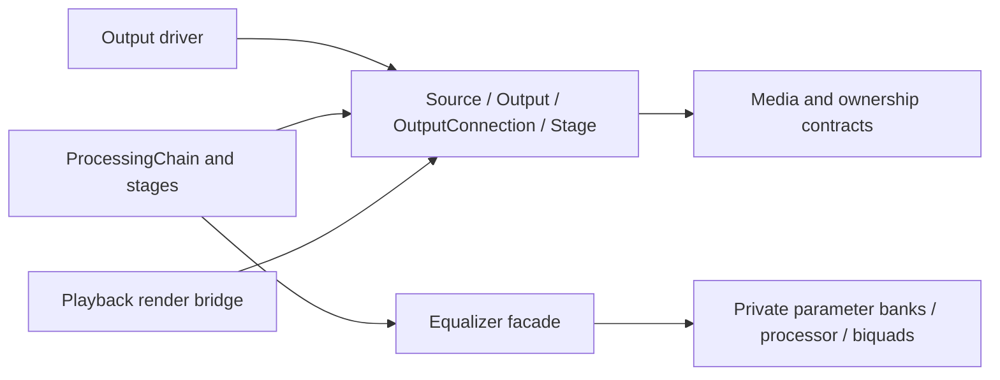

# Audio

This component owns render/output contracts and portable processing. Public headers, complete implementations and focused tests live together. Device construction belongs to the miniaudio driver; the PCM queue/render bridge belongs to playback. No Qt, codec SDK or device backend is required to configure or test this component.

`wiola::audio_output` is header-only. Include `<wiola/audio/source.hpp>`, `<wiola/audio/output.hpp>`, `<wiola/audio/output_connection.hpp>` or the pure `<wiola/audio/stage.hpp>` processing port. The output target has no built-in processing dependency.

`wiola::audio_dsp` supplies the built-in processing chain, equalizer, volume and output sanitizer. Its public configuration uses media/quantity values. Include the corresponding `<wiola/audio/...>` header and link `wiola::audio_dsp`. The separate target keeps output drivers independent of processing implementation.

`Stage::process` and `Source::render` are bounded nonthrowing real-time operations: no allocation, locking, I/O or destruction of owned resources. The control thread calls `Stage::prepare` to allocate independent configuration while existing callbacks may continue. An owned `Stage::Preparation` borrows its stages and discards uncommitted work on destruction. Stop callbacks before its nonthrowing, idempotent `commit`; retire the token on the control thread. `configure` remains the immediate prepare/commit convenience for already stopped output. Stateless stages return a null preparation. A ProcessingChain is a composite Stage and prepares every child before any child changes. A chain borrows its fixed stages; callers retain those objects until callbacks are quiescent. Gain controls follow their documented control-thread/publication rules.

Claim and release output control on the setup thread. Moves leave the prior holder inert; another claim while one is held is inert. An inert preconstructed `OutputConnection` may call `try_acquire` on the setup thread after prior playback joins/releases its claim. This never steals a live claim and repeated acquisition of its own claim is inert. Playback workers do not mutate the claim. Bare control destruction only returns the claim. `OutputConnection` additionally stops the output and waits for callbacks; declare it after source ownership so reverse destruction quiesces readers before releasing storage.

`Equalizer` hides its parameter publication/filter-history implementation behind one owned implementation. Stream reconfiguration prepares complete replacement processing storage before committing; a failed preparation preserves the active state and history. Its configuration references remain valid for the equalizer's lifetime. Processing and gain updates add no allocation; destruction/reconfiguration stay outside callbacks. The [processing guide](processing/README.md) describes thread ownership.

Configure with `-DWIOLA_COMPONENTS=audio`. CMake declares the output/processing targets and their headers. [Tests](tests/README.md) run through ordinary CTest executables linked to those targets.

The private relay and stage/source bridge belong to playback's buffering/render implementation. They are not part of this component's public DSP API. The playback kernel consumes Source/Output/Stage ports without linking the built-in processing archive.

The [miniaudio adapter](miniaudio) implements Output and owns native device callbacks. It is built only with the assembled application; selecting the portable audio component does not prepare that SDK. [Device tests](miniaudio/tests) live with the adapter. Interfaces and implementations share this audio owner: output contracts are here, processing headers sit beside processing implementations, and backend code stays in its named subfolder. All audio contracts, processing implementations and output backends share this owner.

Source files are organized by responsibility. Each target provides its own `wiola/audio/...` include root through build-only forwarders to the authored headers, preserving diagnostics, dependency tracking and compiler coverage.
