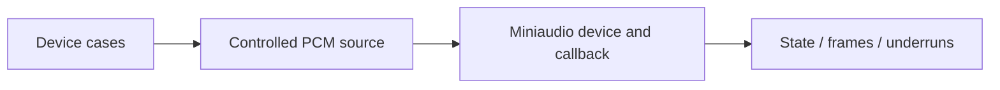

# Miniaudio adapter tests

`audio_device_test` checks pre-start stream facts, device reuse across stop/start, callback requests and underrun accounting through the real adapter and controlled sources.

Runtime cases skip when a playback backend cannot start. Passing these tests does not replace a physical Windows device smoke test. The adapter and test target belong here; portable output and processing tests live in the audio owner's `tests` folder.
