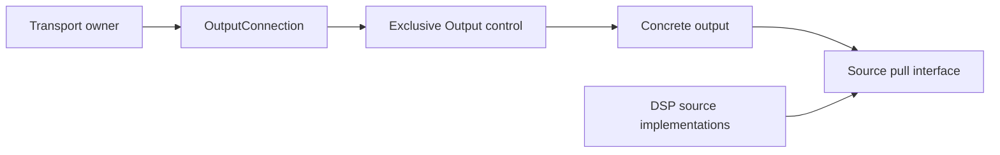

# Audio output boundary

This component owns the PCM pull interface, exclusive output control and callback-quiescence connection. These are one protocol: a concrete output pulls a `Source`, while one `Output::Control` starts and stops it. `OutputConnection` stops that output before the source can be destroyed. No device backend or signal processor is implemented here.

Link `wiola_audio_output`. The headers and connection implementation live together here; [tests](tests/README.md) exercise this protocol without a sound card. The miniaudio implementation lives in the sibling `device` component and consumes these interfaces. DSP and transport can depend on this target without linking the device or codec libraries.

`Source::render` is a bounded, nonthrowing real-time call: implementations must not allocate, lock, access files or destroy owned resources there. The source format is fixed for its lifetime. A short result describes the supplied samples; an output may fill the rest with silence. Blocking decoding belongs to the separate media decoder port.

Claim and release control on the setup/owner thread, outside concurrent callback execution. Moving control clears its previous holder; another claim while it is held is inert. The owner must outlive its control. `stop` waits for active callbacks; declare a connection after source ownership so reverse destruction quiesces callbacks before releasing that source. Releasing a bare control only returns the claim; `OutputConnection` supplies the stop-before-teardown guarantee.

The target still receives legacy foundation headers through `wiola_core`; it is not yet a closed installed package. This dependency is explicit migration debt, separate from the removed device linkage. Public package closure remains separate work. Session receives its provider and output factory explicitly; the desktop host selects the concrete adapters.
