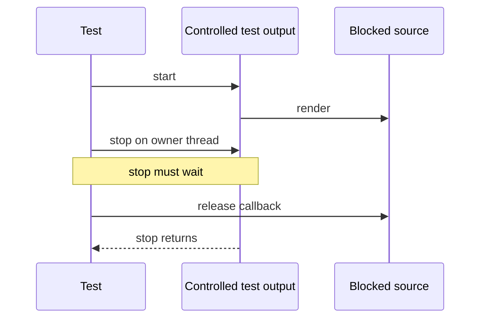

# Output protocol tests

`audio_output_test` exercises exclusive control, move transfer including self-assignment, returning claims, polymorphic source destruction and stopping a blocked callback before teardown. Case names and target identity are preserved. It links the output contract and GoogleTest with the selected build instrumentation; no miniaudio device or codec target is linked.

The shared `tests/fakes/output.hpp` fixture supplies a controlled output used by other engine tests as well. It is a test dependency, not a production driver. The repository's test composition registers this subtree after defining its existing test helper. Run only `audio_output_test` for changes confined to this protocol; caller changes also require their affected targets.
