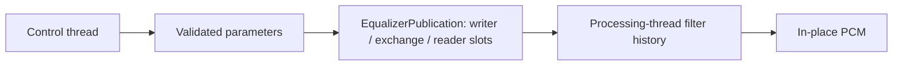

# Audio processing implementation

The equalizer facade owns one stable authored configuration and a replaceable processing state containing `EqualizerParameters` and `EqualizerProcessor`. Parameters copy that small immutable configuration by value, so temporary inputs or later caller mutations cannot invalidate the validated policy. Control-thread parameters own validated gains; `EqualizerPublication` owns the three fixed publication banks and their handoff. The processing-thread processor is a nonmoving sibling that borrows its enclosing Processing object's parameters; that aggregate destroys the processor first. The processor owns filter history and applies one complete bank at a block boundary. Biquads, coefficient calculation and prepared-bank layout remain private here.

Construct and configure outside playback callbacks. Parameter updates prepare a bank without heap allocation; processing adopts a complete bank without reclaiming dynamic objects. Stop output before reconfiguring stream shape or destroying stages. The implementation/configuration remain stable because the equalizer is noncopyable and nonmovable. Stream preparation first allocates and builds an independent state without changing the active one. Commit copies the latest accepted gains/enabled state and swaps ownership without throwing. A preparation borrows its stage, which must outlive it; discarded candidates have no effect. Repeated commit is inert. A failed allocation destroys only the candidate; active banks, filter history, settings and configuration references survive unchanged. Successful configuration starts fresh filter history for the new stream. The retired state stays owned by the preparation until its destruction on the control thread. It is never reclaimed in a callback.

ProcessingChain keeps a fixed sequence of borrowed stages and a final sanitizer. Volume publishes bounded gain atomically. Relay publishes a borrowed source pointer; callback quiescence establishes when a former source can be released. These mechanisms share the component but retain their distinct lifetime rules.

Private filter/parameter/processor headers are neither installed nor reachable through the public include root. Only the biquad and publication implementation tests add this scoped private include directory. The public API and native library/vendor types do not depend on each other.

`EqualizerPublication` keeps one writer slot, one reader slot and one atomic exchange slot. Publishing replaces/coalesces the pending bank with one exchange. Acquisition checks for a pending update and exchanges at most once; otherwise it retains its current bank. There is no compare-exchange retry loop in either path. Fixed-size trivial bank storage and lock-free index atomics are compile-time invariants. This bounds algorithmic work; OS scheduling and target instruction timing are separate platform concerns.

The reader's bank remains immutable until that reader acquires again. Its next exchange releases the former read slot after the previous block finished using it. The writer acquires a released spare before reusing it; the reader acquires completed publication before reading it. Reconfiguration may transfer the reader role to setup code only after callbacks have stopped. The two roles each have one thread and no reentrant acquisition.

`ProcessingChain` implements the same Stage preparation port. It collects owned child preparations before returning a composite token; construction/child failure releases every candidate. Only commit activates children, after callbacks stop. Volume and output sanitizer are stream-independent and prepare no token. New stages implement this explicit two-phase contract rather than relying on catch-and-reconfigure rollback.
