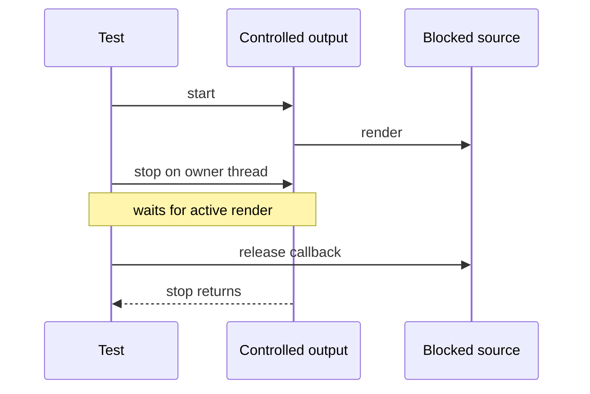

# Audio contract tests

`audio_output_test` links only the public output target, GoogleTest, Threads and selected instrumentation. Existing case names are preserved. It checks exclusive controls, move/self-move transfer, returned claims, polymorphic source destruction, refused starts and callback quiescence. Connection destruction also verifies stop-before-release and that destroying an inert second connection cannot stop the live output.

The shared controlled output in `tests/fakes/output.hpp` is a test-only collaborator also used by playback suites. Its include root is private to the test executable, never an exported production dependency. No production device, FFmpeg or Qt target is needed.

`consumer.cpp` implements both ports and checks render/control/connection behavior. `AudioOutput.Consumer` is an ordinary C++ executable linked only to `wiola::audio_output`; it uses the same configured compiler and build controls as the component.

The [processing suites](processing/README.md) and `AudioProcessing.Consumer` link `wiola::audio_dsp`. `audio_tone_test` checks the shared controlled source through the output contract only; it does not link processing.

Connection handoff cases qualify a candidate prepared while the old claim is held, a retry after its release, two candidates competing for one returned claim and repeated acquisition preserving a live connection. These operations run on the setup thread; callbacks only use the already acquired control.
