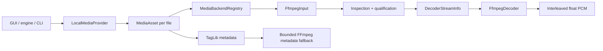
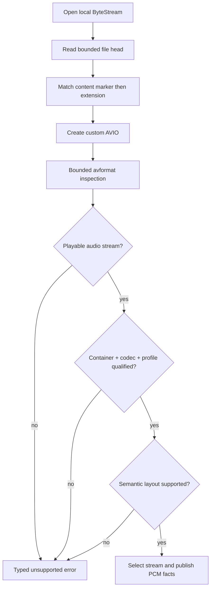
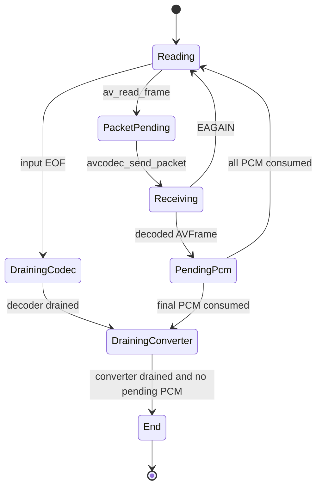
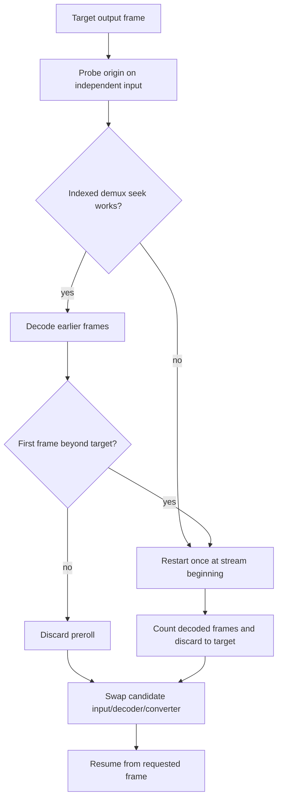

# Audio decoding

The codec layer turns local files into independent streams of interleaved `float` PCM. FFmpeg is the
only decoding backend. Miniaudio is outside this layer and is used only for playback devices.

## Map

- `provider.*`: `LocalMediaProvider` and per-file `MediaAsset` objects.
- `decode/decoder.*`: neutral stream information, read outcomes, seek outcomes, and cursor rules.
- `decode/format.*`: owned format descriptors and content markers.
- `decode/registry.*`: bounded, deterministic backend probing.
- `backends/ffmpeg/`: private demux, decode, conversion, metadata, and qualification code.
- `backends/taglib/`: metadata-first reading; FFmpeg supplies bounded fallback fields and artwork.
- `../pcm/stream_spec.hpp`: sample rate, channel count, and semantic channel layout.

Application and engine code use only the neutral provider/decoder interfaces. FFmpeg types stay in
`backends/ffmpeg` and never cross those interfaces.

An asset identifies a file; it is not a shared playback cursor. `create_decoder()` always creates
independent input, demux, codec, converter, and timestamp state.

## Opening and inspection

`FfmpegInput` owns the file stream, AVIO buffer, and format context. Secondary URL opens are rejected;
network protocols are not built. Probe size, analysis time, backend attempts, and decoder work loops
are bounded.

The matrix in `backends/ffmpeg/qualification.cpp` is the acceptance list. An enabled FFmpeg decoder or
a known suffix is not sufficient. Each record has a real fixture in
`tests/codec/ffmpeg_qualification_test.cpp`.

## Decode state

`PacketDecoder` handles packet ownership and delayed decoder output. `PcmConverter` converts packed or
planar representations to interleaved float, preserves the declared rate and semantic layout, and
keeps only bounded pending PCM. A read may contain audio and EOF together; a short read alone is not
EOF.

Length is `exact`, `estimated`, or `unknown`. Exact lengths trim final padding. Estimated and unknown
lengths never clamp audible output or turn a shorter-than-estimated file into damage.

## Seek transaction

A seek is staged on a fresh candidate and committed only after the requested audible frame is ready.
A failed seek leaves the old decoder position and subsequent samples intact.

Origin probing is independent so demux and codec state for the real seek stays fresh. MP3 uses
sequential preroll because its demux seek can otherwise produce silence. Coarse-timestamp fallbacks
count decoded frames instead of trusting rounded timestamps. Fresh-stream origin and per-link state
are preserved correctly when playback resumes.

## Chained inputs and channel layouts

Equal-shape links may continue. Timestamp resets establish a new link base at the current output
position; stale priming is skipped. Rate, channel-count, sample-format, or semantic-layout changes
are rejected before differently shaped PCM reaches the queue.

Mono and stereo are supported. Surround is deliberately narrow: explicit 5.1-side order is preserved
through conversion and the device channel map, with no silent downmix. Other mappings, including 6.1,
are rejected rather than inferred from channel count.

## Adding a format

1. Add only the required FFmpeg demuxer/decoder to `cmake/ffmpeg.cmake`.
2. Add a content marker and suffix to the descriptor in `backends/ffmpeg/decoder.cpp`.
3. Add the container/codec/profile record to `qualification.cpp`.
4. Add a small independently produced fixture and its expected PCM shape to the qualification test.
5. Verify open, nonempty decode, final drain, metadata behavior, and declared seek/length behavior.
6. Add corruption and format-change cases where the container needs them.

Do not advertise a codec family from one profile. Do not enable network access, video decoding, or
secondary resource opening as a side effect.

## Useful checks

- `ctest --preset linux -R 'FfmpegQualification|BackendQualification'`
- `ctest --preset linux -R 'FfmpegDecoder|OggQualification|Mp4Qualification'`
- `ctest --preset linux-asan -R 'FfmpegHardening|FfmpegMetadata'`
- `cmake --build --preset linux-headless -j`
- `cmake --build --preset windows-release -j`

Native Windows runtime behavior must be tested on Windows; a MinGW cross-build and import inspection
alone are not playback evidence.
