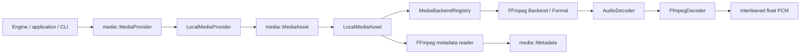
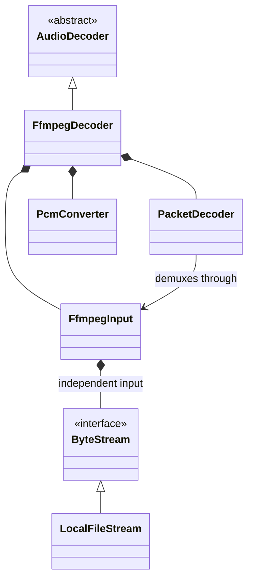
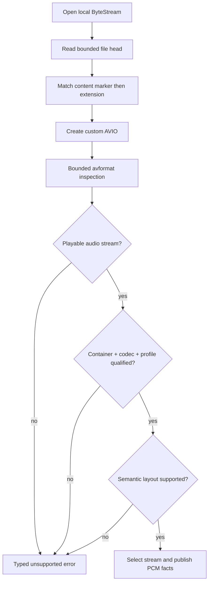
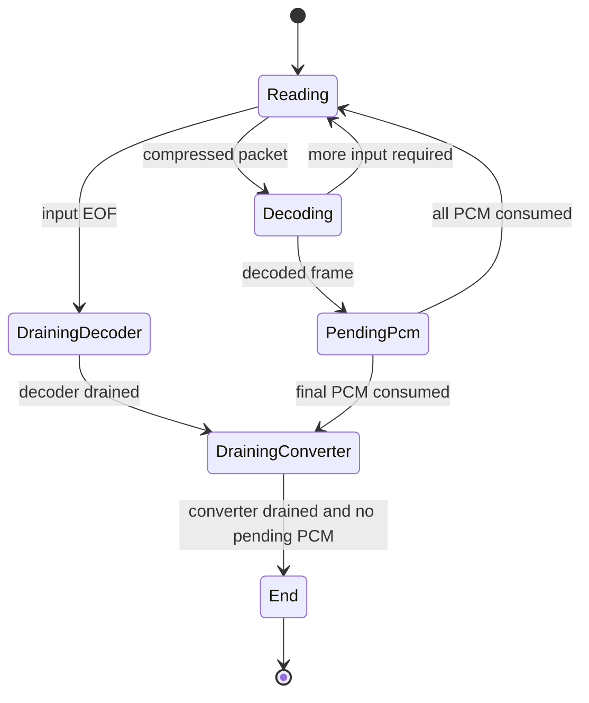
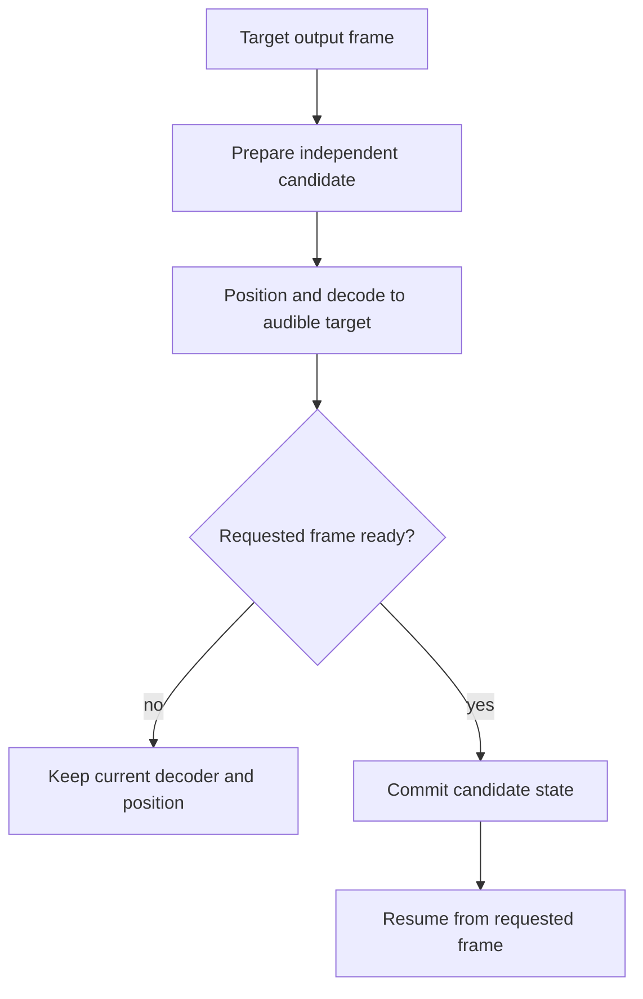

# Codec architecture

The codec layer identifies local media, reads its metadata, and produces independent streams of
interleaved floating-point PCM. FFmpeg is the only decoding and metadata backend. Audio output is a
separate concern: Miniaudio belongs to the [audio device layer](../audio/device/device.hpp), not the
codec layer.

This document describes responsibilities and contracts. The linked headers are the source of truth
for exact types and function signatures.

## Layers and ownership

| Area | Types | Responsibility |
| --- | --- | --- |
| Public media facade | [`media::MediaProvider`](../media/provider.hpp), [`media::MediaAsset`](../media/provider.hpp) | Backend-neutral access to one resource, its facts, its metadata, and new decoders. |
| Local facade implementation | [`LocalMediaProvider`](provider.hpp), [`LocalMediaAsset`](provider.cpp) | Connects local files to the registry and metadata reader. An asset has no shared playback cursor. |
| Decoder contract | [`AudioDecoder`](decode/decoder.hpp), also exposed as [`Decoder`](decode/decoder.hpp) | Defines PCM reads, stream information, position tracking, and transactional seeking. |
| Format discovery | [`MediaBackendRegistry`](decode/registry.hpp), [`Backend`](decode/format.hpp), [`Format`](decode/format.hpp) | Orders bounded backend probes using content markers and extensions. |
| FFmpeg backend | [`FfmpegDecoder`](backends/ffmpeg/decoder.hpp) and its [private collaborators](#ffmpeg-collaborators) | Demuxes, decodes, converts, inspects, and seeks without exposing FFmpeg types publicly. |
| Metadata | [`read_metadata`](backends/ffmpeg/metadata.hpp), [`read_artwork`](backends/ffmpeg/metadata.hpp) | Reads bounded text, duration, and attached artwork through an independent FFmpeg input. |
| Supporting values | [`media::Metadata`](../media/media.hpp), [`pcm::StreamSpec`](../pcm/stream_spec.hpp), [`pcm::Frames`](../pcm/stream_spec.hpp), [`media::Result`](../media/result.hpp) | Keep metadata, PCM geometry, frame counts, and failures explicit and backend-neutral. |

The application depends on the neutral interfaces above the FFmpeg boundary. Constructing another
decoder from the same asset creates another independent decoding state machine.

## Public decoder model

[`AudioDecoder`](decode/decoder.hpp) is the abstract base for all playback decoders. Its public API
owns common stream policy; a backend supplies only stream-specific decoding and seek operations.

| Contract type | Meaning |
| --- | --- |
| [`DecoderStreamInfo`](decode/decoder.hpp) | PCM shape, optional frame length, length accuracy, and seek capability. |
| [`LengthAccuracy`](decode/decoder.hpp) | Distinguishes exact, estimated, and unknown lengths so estimates do not truncate audio. |
| [`DecodeOutcome`](decode/decoder.hpp) | Reports produced frames and explicit end-of-stream together. |
| [`SeekOutcome`](decode/decoder.hpp) | Reports the requested target, achieved frame, and whether positioning was exact. |
| [`Opened`](decode/open.hpp) | Contains either an owned decoder or a typed media error. |

Key rules:

- [`read`](decode/decoder.hpp) consumes whole PCM frames. A short read is not implicitly EOF.
- [`render`](decode/decoder.hpp) is the sample-count convenience view of the same read operation.
- Exact lengths constrain output; estimated and unknown lengths do not.
- [`seek`](decode/decoder.hpp) preserves the old position when the backend cannot complete the seek.
- [`position_frames`](decode/decoder.hpp) and terminal state belong to the public base, so callers
  observe the same cursor rules for every backend.
- PCM shape is described by [`pcm::StreamSpec`](../pcm/stream_spec.hpp); channel layout is semantic,
  not inferred solely from channel count.

The neutral contract is exercised by [`audio_decoder_test.cpp`](../../tests/codec/audio_decoder_test.cpp)
and [`decoder_test.cpp`](../../tests/codec/decoder_test.cpp).

## Format discovery and admission

Discovery answers “which backend should accept this file?” It does not decide whether a particular
codec profile is playable.

| Type | Role |
| --- | --- |
| [`FileHead`](decode/format.hpp) | Bounded leading-byte view used for signature matching. |
| [`Marker`](decode/format.hpp) | Declarative content signature at a fixed offset. |
| [`Format`](decode/format.hpp) | Owned name, markers, extensions, opener, and capabilities for one format family. |
| [`Backend`](decode/format.hpp) | Groups formats behind one opener and capability set. |
| [`BackendCapabilities`](decode/format.hpp) | Separates advertised playback and metadata capabilities. |
| [`Match`](decode/format.hpp) | Ranks signature, extension, and weaker reasons to attempt a backend. |
| [`MediaBackendRegistry`](decode/registry.hpp) | Performs deterministic, bounded, cancellable acceptance probes and returns typed failures. |

The default registry contains the [`ffmpeg::backend`](backends/ffmpeg/decoder.hpp). Its format
catalog advertises container families; the separate [`Qualification`](backends/ffmpeg/qualification.hpp)
set admits only explicitly supported container, codec, and profile combinations after inspection.
This keeps file recognition, FFmpeg capability, and Wiola support policy distinct.

Relevant contracts live in [`format_test.cpp`](../../tests/codec/format_test.cpp),
[`registry_test.cpp`](../../tests/codec/registry_test.cpp),
[`backend_qualification_test.cpp`](../../tests/codec/backend_qualification_test.cpp), and
[`ffmpeg_qualification_test.cpp`](../../tests/codec/ffmpeg_qualification_test.cpp).

## FFmpeg collaborators

FFmpeg headers and ownership are private to [`backends/ffmpeg`](backends/ffmpeg/). The neutral
[`AudioDecoder`](decode/decoder.hpp) boundary does not expose packets, codec contexts, dictionaries,
or channel-layout bit masks.

| Collaborator | Ownership and role |
| --- | --- |
| [`FfmpegDecoder`](backends/ffmpeg/decoder.hpp) | Implements the neutral decoder contract and coordinates input, packets, conversion, stream position, and seeking. |
| [`FfmpegInput`](backends/ffmpeg/input.hpp) | Owns an independent byte stream and FFmpeg demux input; selects a qualified audio stream and publishes neutral stream facts. |
| [`FfmpegStreamFacts`](backends/ffmpeg/input.hpp) | Connects the selected FFmpeg stream index to [`DecoderStreamInfo`](decode/decoder.hpp). |
| [`PacketDecoder`](backends/ffmpeg/packet_decoder.hpp) | Owns codec, packet, and frame state; presents decoded frames and explicit terminal events. |
| [`FfmpegFrameEvent`](backends/ffmpeg/packet_decoder.hpp) | Backend-internal decoded-frame or end-of-stream result. |
| [`PcmConverter`](backends/ffmpeg/pcm_converter.hpp) | Converts decoded representations to the declared interleaved float PCM shape and holds bounded pending output. |
| [`read_metadata`](backends/ffmpeg/metadata.hpp) | Uses separate input state for bounded metadata and artwork reads. |
| [`Qualification`](backends/ffmpeg/qualification.hpp) | Machine-readable support record; the complete set is defined in [`qualification.cpp`](backends/ffmpeg/qualification.cpp). |

[`media::ByteStream`](../media/byte_stream.hpp) isolates FFmpeg I/O from filenames and the standard
file API. [`media::LocalFileStream`](../media/local_file_stream.hpp) is the local-file implementation.
Each input owns its stream, so metadata inspection, decoder creation, and seek preparation do not
share a file cursor accidentally.

Backend behavior is covered by [`ffmpeg_io_test.cpp`](../../tests/codec/ffmpeg_io_test.cpp),
[`ffmpeg_packet_decoder_test.cpp`](../../tests/codec/ffmpeg_packet_decoder_test.cpp),
[`ffmpeg_pcm_test.cpp`](../../tests/codec/ffmpeg_pcm_test.cpp), and the format-specific tests listed
[below](#test-map).

## Operation contracts

### Open and inspect

[`LocalMediaProvider::open`](provider.cpp) establishes access to a local resource and returns an
asset. The asset uses [`MediaBackendRegistry`](decode/registry.hpp) for decoder creation and the
[FFmpeg metadata reader](backends/ffmpeg/metadata.hpp) for metadata. Decoder inspection selects only
a supported audio stream and converts backend facts into [`media::MediaInfo`](../media/media.hpp).

Recognition by suffix alone is not acceptance. The backend must recognize the content, find a
supported semantic channel layout, and pass the qualification policy. Secondary resource opens are
rejected, and probing work is bounded.

### Decode

A decoder turns backend frame events into neutral [`DecodeOutcome`](decode/decoder.hpp) values.
Packet draining, conversion draining, codec delay, and timestamp handling remain behind
[`FfmpegDecoder`](backends/ffmpeg/decoder.hpp). Callers see only PCM frames, progress, EOF, or a
typed failure.

A read may contain audio and EOF together. Exact lengths trim final padding; estimated and unknown
lengths never clamp audible output or turn a shorter-than-estimated file into damage.

### Seek

The public [`AudioDecoder`](decode/decoder.hpp) API exposes a frame-targeted, transactional contract.
Codec-specific positioning and any required preroll are private to
[`FfmpegDecoder`](backends/ffmpeg/decoder.hpp). Failure does not replace the caller's current decode
position with partially prepared state.

### Metadata

[`LocalMediaAsset::read_metadata`](provider.cpp) calls FFmpeg directly. Text and artwork are bounded,
absent fields remain absent, and duration uses the same neutral time representation as the rest of
the media layer. Metadata reading does not consume or reset a playback decoder.

### Chained inputs and channel layouts

Equal-shape links may continue, with backend timestamp state rebased at the current output position.
Rate, channel-count, sample-format, or semantic-layout changes are rejected before differently shaped
PCM reaches the queue.

Mono and stereo are supported. Explicit 5.1-side order is preserved through conversion and the
device channel map, with no silent downmix. Other mappings are rejected rather than inferred from
channel count.

## Dependency rules

1. Application and engine code depend on [`media::MediaAsset`](../media/provider.hpp) and
   [`AudioDecoder`](decode/decoder.hpp), not concrete FFmpeg types.
2. [`provider.hpp`](provider.hpp) and [`decode/`](decode/) contain no FFmpeg headers.
3. [`FfmpegDecoder`](backends/ffmpeg/decoder.hpp) is one implementation of the neutral contract;
   registry data selects backends without making the decoder interface format-specific.
4. Assets and decoders have different lifetimes: an asset can create multiple decoders, while each
   decoder owns one playback position.
5. PCM output uses the shared [`pcm::StreamSpec`](../pcm/stream_spec.hpp) contract; audio-device
   configuration and playback remain outside `codec`.
6. Errors travel as [`media::Result`](../media/result.hpp) values with categories from
   [`media::ErrorCategory`](../media/result.hpp), rather than backend error codes leaking upward.

## Extending format support

1. Enable only the required FFmpeg demuxer/decoder in [`cmake/ffmpeg.cmake`](../../cmake/ffmpeg.cmake).
2. Add content markers and suffixes to the catalog in [`decoder.cpp`](backends/ffmpeg/decoder.cpp).
3. Add the container/codec/profile record to [`qualification.cpp`](backends/ffmpeg/qualification.cpp).
4. Add a small independently produced fixture and its expected PCM shape to
   [`ffmpeg_qualification_test.cpp`](../../tests/codec/ffmpeg_qualification_test.cpp).
5. Verify open, nonempty decode, final drain, metadata behavior, and declared seek/length behavior.
6. Add corruption and format-change cases where the container needs them.

Do not advertise a codec family from one profile. Do not enable network access, video decoding, or
secondary resource opening as a side effect.

## Test map

| Concern | Tests |
| --- | --- |
| Provider facade and independent decoders | [`provider_test.cpp`](../../tests/codec/provider_test.cpp) |
| Public decoder progress, length, and seek policy | [`audio_decoder_test.cpp`](../../tests/codec/audio_decoder_test.cpp), [`decoder_test.cpp`](../../tests/codec/decoder_test.cpp) |
| Format matching and registry behavior | [`format_test.cpp`](../../tests/codec/format_test.cpp), [`registry_test.cpp`](../../tests/codec/registry_test.cpp) |
| FFmpeg input, packets, and PCM conversion | [`ffmpeg_io_test.cpp`](../../tests/codec/ffmpeg_io_test.cpp), [`ffmpeg_packet_decoder_test.cpp`](../../tests/codec/ffmpeg_packet_decoder_test.cpp), [`ffmpeg_pcm_test.cpp`](../../tests/codec/ffmpeg_pcm_test.cpp) |
| Metadata, Unicode, artwork, and limits | [`ffmpeg_metadata_test.cpp`](../../tests/codec/ffmpeg_metadata_test.cpp) |
| Qualification and corruption boundaries | [`ffmpeg_qualification_test.cpp`](../../tests/codec/ffmpeg_qualification_test.cpp), [`ffmpeg_hardening_test.cpp`](../../tests/codec/ffmpeg_hardening_test.cpp) |
| Containers, chaining, lossless formats, and sampled files | [`ffmpeg_container_test.cpp`](../../tests/codec/ffmpeg_container_test.cpp), [`ffmpeg_ogg_test.cpp`](../../tests/codec/ffmpeg_ogg_test.cpp), [`ffmpeg_lossless_test.cpp`](../../tests/codec/ffmpeg_lossless_test.cpp), [`ffmpeg_sampled_file_test.cpp`](../../tests/codec/ffmpeg_sampled_file_test.cpp) |
| MP4, ADTS, and channel layouts | [`ffmpeg_mp4_test.cpp`](../../tests/codec/ffmpeg_mp4_test.cpp), [`ffmpeg_adts_test.cpp`](../../tests/codec/ffmpeg_adts_test.cpp), [`ffmpeg_channel_layout_test.cpp`](../../tests/codec/ffmpeg_channel_layout_test.cpp) |
| FFmpeg build surface | [`ffmpeg_build_test.cpp`](../../tests/codec/ffmpeg_build_test.cpp), [`cmake/ffmpeg.cmake`](../../cmake/ffmpeg.cmake) |

Useful entry points for changes are the [codec build targets](CMakeLists.txt),
[FFmpeg backend target](backends/ffmpeg/CMakeLists.txt), and
[codec test registration](../../tests/codec/CMakeLists.txt).

## Useful checks

- `ctest --preset linux-debug -R 'FfmpegQualification|BackendQualification'`
- `ctest --preset linux-debug -R 'FfmpegDecoder|FfmpegMetadata'`
- `ctest --preset linux-asan -R 'FfmpegHardening|FfmpegMetadata'`
- `cmake --build --preset linux-headless -j`
- `cmake --build --preset windows-release -j`

Native Windows runtime behavior must be tested on Windows; a MinGW cross-build and import inspection
alone are not playback evidence.
