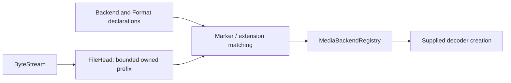

# Codec recognition and registration

This owner contains bounded leading-byte recognition, backend/format declarations and registry selection. Concrete container/codec work stays under the backend owner; byte access uses the public media port.

FileHead propagates read failure separately from an empty prefix. A marker's offset must lie within retained bytes, then its length must fit the remaining range before any span is formed. This subtraction-based check cannot wrap an offset-plus-length sum. Empty marker ranges match only valid positions, including the retained end; descriptor qualification owns any stronger signature policy.

Signature tests use owned in-memory bytes, independent of native files. They cover ordinary offsets, short input, high byte values, empty/end ranges and maximal offsets that previously caused an ASan stack underflow. Native file admission and codec input are tested by their actual owners.
