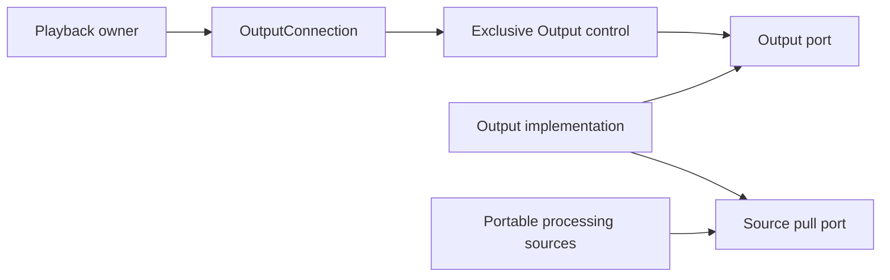

# Audio contracts

This component owns the PCM pull interface, exclusive output control and the connection that quiesces callbacks before source teardown. `Source`, `Output` and `OutputConnection` form one protocol. Their small definitions are header-only; the public target adds no device, decoder or GUI implementation.

Link `wiola::audio_output` and include `<wiola/audio/source.hpp>`, `<wiola/audio/output.hpp>` or `<wiola/audio/output_connection.hpp>`. Only `public/` is exported. The target depends on the media and borrowed-reference APIs; it has no checkout-wide include path. Configure only this closure with `-DWIOLA_COMPONENTS=audio`, or consume its installed target with `find_package(wiola_audio CONFIG REQUIRED)`.

`Source::render` is a bounded, nonthrowing real-time call: no allocation, locking, I/O or destruction of owned resources may occur there. Its stream format stays fixed for its lifetime. The sample count is bounded by the supplied span. Blocking decoding belongs to the separate media decoder contract.

Claim and release output control on the setup/owner thread. Moving control clears its previous holder; another claim while one is held is inert. The output outlives its control. Releasing a bare control only returns the claim; `OutputConnection` also stops the output and waits for active callbacks. Declare it after the source ownership so reverse destruction quiesces callbacks before releasing the source.

The complete protocol and [tests](tests/README.md) live here. Device construction remains in the miniaudio adapter; processing and transport consume the same public contract without linking that adapter.
