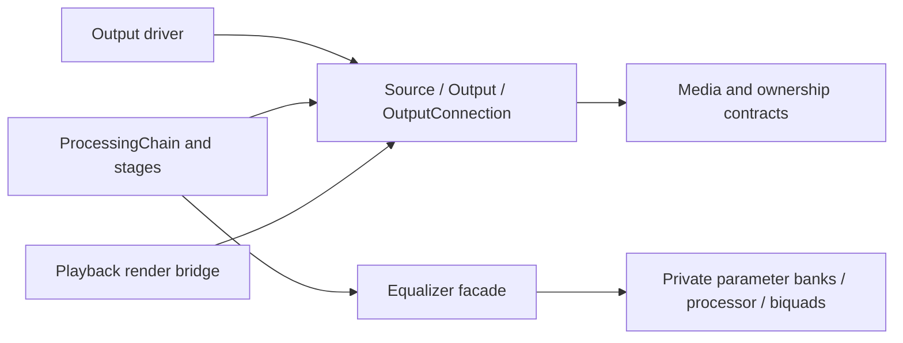

# Portable audio

This component owns render/output contracts and portable processing. Public headers, complete implementations and focused tests live together. Device construction belongs to the miniaudio driver; the PCM queue/render bridge belongs to playback. No Qt, codec SDK or device backend is required to configure or test this component.

`wiola::audio_output` is header-only. Include `<wiola/audio/source.hpp>`, `<wiola/audio/output.hpp>` or `<wiola/audio/output_connection.hpp>`. An output-only installation contains no processing archive or processing headers. Installed consumers use `find_package(wiola_audio CONFIG REQUIRED COMPONENTS output)`.

`wiola::audio_dsp` supplies stages, processing chain, equalizer, volume, output sanitizer, relay and source shaping. Its public configuration uses media/quantity values. Include the corresponding `<wiola/audio/...>` header and use `find_package(wiola_audio CONFIG REQUIRED COMPONENTS dsp)`. The separate target keeps output drivers independent of processing implementation.

`Stage::process` and `Source::render` are bounded nonthrowing real-time operations: no allocation, locking, I/O or destruction of owned resources. The control thread calls `Stage::prepare` to allocate independent configuration while existing callbacks may continue. An owned `Stage::Preparation` borrows its stages and discards uncommitted work on destruction. Stop callbacks before its nonthrowing, idempotent `commit`; retire the token on the control thread. `configure` remains the immediate prepare/commit convenience for already stopped output. Stateless stages return a null preparation. A ProcessingChain is a composite Stage and prepares every child before any child changes. A chain borrows its fixed stages, and a relay borrows its selected source; callers retain those objects until callbacks are quiescent. Gain controls follow their documented control-thread/publication rules.

Claim and release output control on the setup thread. Moves leave the prior holder inert; another claim while one is held is inert. An inert preconstructed `OutputConnection` may call `try_acquire` on the setup thread after prior playback joins/releases its claim. This never steals a live claim and repeated acquisition of its own claim is inert. Playback workers do not mutate the claim. Bare control destruction only returns the claim. `OutputConnection` additionally stops the output and waits for callbacks; declare it after source ownership so reverse destruction quiesces readers before releasing storage.

`Equalizer` hides its parameter publication/filter-history implementation behind one owned implementation. Stream reconfiguration prepares complete replacement processing storage before committing; a failed preparation preserves the active state and history. Its configuration references remain valid for the equalizer's lifetime. Processing and gain updates add no allocation; destruction/reconfiguration stay outside callbacks. The [private processing guide](private/processing/README.md) describes thread ownership.

Configure with `-DWIOLA_COMPONENTS=audio`. CMake header file sets define the actual output/processing install surfaces; only supported public headers are installed. [Tests](tests/README.md) run directly through CTest and ordinary relocated C++ consumers, without manifests or custom runners.
