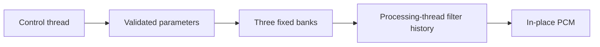

# Audio processing implementation

The equalizer facade owns one implementation containing `EqualizerParameters` and `EqualizerProcessor`. Control-thread parameters own validated gains and three fixed publication banks. The processing-thread processor owns filter history and applies one complete bank at a block boundary. Biquads, coefficient calculation and prepared-bank layout remain private here.

Construct and configure outside playback callbacks. Parameter updates prepare a bank without heap allocation; processing adopts a complete bank without reclaiming dynamic objects. Stop output before reconfiguring stream shape or destroying stages. The implementation pointer remains stable because the equalizer is noncopyable and nonmovable.

ProcessingChain keeps a fixed sequence of borrowed stages and a final sanitizer. Volume publishes bounded gain atomically. Relay publishes a borrowed source pointer; callback quiescence establishes when a former source can be released. These mechanisms share the component but retain their distinct lifetime rules.

Private filter/parameter/processor headers are neither installed nor reachable through the public include root. Only the biquad implementation test adds this scoped private include directory. The public API and native library/vendor types do not depend on each other.
