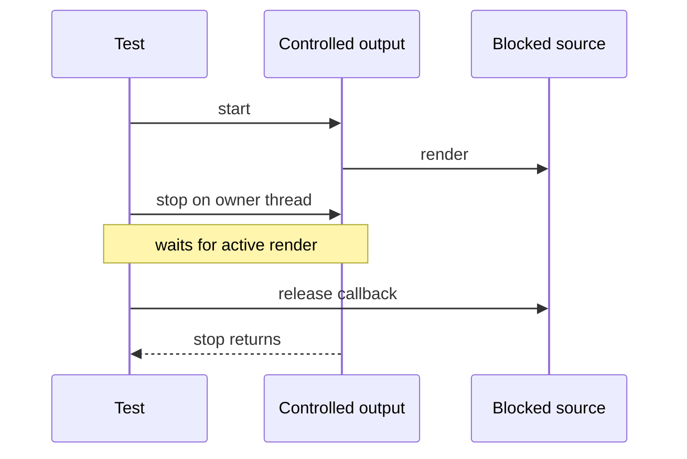

# Audio contract tests

`audio_output_test` links only the public output target, GoogleTest, Threads and selected instrumentation. Existing case names are preserved. It checks exclusive controls, move/self-move transfer, returned claims, polymorphic source destruction, refused starts and callback quiescence. Connection destruction also verifies stop-before-release and that destroying an inert second connection cannot stop the live output.

The shared controlled output in `tests/fakes/output.hpp` is a test-only collaborator also used by playback suites. Its include root is private to the test executable, never an exported production dependency. No production device, FFmpeg or Qt target is needed.

`consumer.cpp` implements both ports against installed headers and checks render/control/connection behavior. `AudioOutput.InstalledConsumer` installs and relocates the actual package, compiles every installed header independently and links this consumer through `wiola::audio_output`. Native consumers run; cross consumers only compile/link. Ordinary CMake retains its phase logs under the build's `Testing/PublicPackage-*` directory.
