# Portable media contracts

```mermaid
flowchart LR
    Consumer[Playback or analysis consumer] --> Media[Public media contracts]
    Provider[Concrete provider] --> Media
    Decoder[Concrete decoder] --> Media
    Stream[Concrete byte stream] --> Media
    Media --> Quantities[Time and frequency quantities]
    Media --> Validation[Shared stream admission and decoder validation]
```

This component owns resource access, metadata and artwork values, byte-stream and decoder ports, cooperative operation context, typed results, and the PCM stream vocabulary those ports exchange. Related declarations share one component rather than separate targets for every value type. Link `wiola::media` and include headers from `<wiola/media/...>`. The sole nonstandard dependency is `wiola::quantities`.

`public/wiola/media` is the complete exported header tree. `private/audio_decoder.cpp` implements decoder validation; `private/byte_stream.cpp` owns byte-operation admission. `tests` contains the deterministic stream, decoder, ownership, metadata and PCM suites. `package.cmake` resolves the public quantities dependency for installed consumers. Neither source-root includes nor native filesystem, FFmpeg, device, registry or GUI implementations are exported. Existing concrete local-file code remains outside this component under `src/media`.

ByteStream callers use nonvirtual `read`, `seek` and `tell`. Drivers override the protected `read_impl`, `seek_impl` and `tell_impl` hooks. The public operations reject an already stopped/expired context before backend work and forward that same context for continued cooperation. A zero-length read succeeds without invoking a backend; a nonempty read can report short EOF, but never more bytes than its span. Backend failures remain typed, including unsupported movement or unknown position, and unexpected exceptions retain the caller's existing policy. A failed seek must preserve the backend cursor. Current FFmpeg input requires size-discoverable seekable bytes; signature reading can use forward-only input. No transport scheme or filename dispatch belongs to this port.

Implement a decoder by deriving from `AudioDecoder` and supplying stream information, `decode` and `seek_frame`. Shared validation owns whole-frame alignment, exact-length bounds, decoded position, explicit exhaustion and typed failure propagation. A short read is progress rather than implicit EOF. A nonempty successful read advances or reports EOF. A zero-capacity read/render request does not call the backend or move position; it reports EOF only when the stream is already known to be at its end. Estimated and unknown lengths do not clamp reads. A failed seek leaves the contract's position and exhaustion state unchanged; implementations must make their backend seek transactional and report the achieved position. An exact seek outcome must achieve its target, and every achieved position must respect an exact stream length. Approximate seeks may report a different position within those bounds; estimated and unknown duration hints do not bound seeks.

The caller owns and serializes blocking decoder operations on a worker. Stream information is immutable after construction, enforced by its const storage. Shared read/seek validation rejects an invalid numeric stream specification or a missing exact-length value with a typed damaged-media error before frame arithmetic or backend calls. Valid empty exact streams and unbounded estimated/unknown streams retain their behavior. No scheduler, thread, device callback or backend selection is provided here. `DecoderOpenResult` transfers decoder ownership on success. An asset need not outlive the decoder it creates. `OperationContext` carries cooperative cancellation and a steady-clock deadline; providers and streams choose where to check it. Provider identification currently accepts a filesystem path; opening an asset does not itself create playback/output state.

`DecoderStreamInfo::validate` owns those stream-fact invariants. A consumer can validate admission before preparing playback resources; read and seek use the same operation before backend calls. Validation reads immutable facts without probing or advancing the decoder, and returns the same typed diagnostic at either boundary.

Configure the owning repository with `-DWIOLA_COMPONENTS=media`; unrelated SDKs are not prepared. Local test targets link only the public component, GoogleTest and build instrumentation. The installed package is `wiola_media`; install its component and `wiola_quantities`, then use `find_package(wiola_media CONFIG REQUIRED)` and `wiola::media` from a consumer outside the checkout. Instrumented archives retain the selected instrumentation runtime link options without exporting project-private build targets.

The legacy `wiola_core` umbrella temporarily forwards this public target for unmigrated callers. This component does not depend on that umbrella. Concrete driver integration tests remain outside this subtree and are not a prerequisite for editing media contracts.

Use an instrumented build and the standard LLVM reports to inspect this component's coverage. For a focused local report, run `python3 -m scripts.coverage --build-dir BUILD --source src/core/media --exclude '/tests/' --target media_audio_decoder_contract_test media_audio_decoder_port_test`. This runs the selected configured tests and reports their mappings; it does not define source ownership, architecture rules or coverage thresholds. CI controls coverage acceptance.
