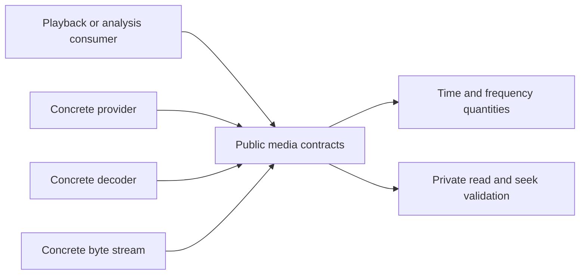

# Portable media contracts

This component owns resource access, metadata and artwork values, byte-stream and decoder ports, cooperative operation context, typed results, and the PCM stream vocabulary those ports exchange. Related declarations share one component rather than separate targets for every value type. Link `wiola::media` and include headers from `<wiola/media/...>`. The sole nonstandard dependency is `wiola::quantities`.

`public/wiola/media` is the complete exported header tree. `private/audio_decoder.cpp` implements shared decoder validation. `tests` contains the deterministic decoder, ownership, metadata and PCM suites. `package.cmake` resolves the public quantities dependency for installed consumers. Neither source-root includes nor native filesystem, FFmpeg, device, registry or GUI implementations are exported. Existing concrete local-file code remains outside this component under `src/media`; its driver ownership is still legacy code.

Implement a decoder by deriving from `AudioDecoder` and supplying stream information, `decode` and `seek_frame`. Shared validation owns whole-frame alignment, exact-length bounds, decoded position, explicit exhaustion and typed failure propagation. A short read is progress rather than implicit EOF. A nonempty successful read advances or reports EOF. A zero-capacity read/render request does not call the backend or move position; it reports EOF only when the stream is already known to be at its end. Estimated and unknown lengths do not clamp reads. A failed seek leaves the contract's position and exhaustion state unchanged; implementations must make their backend seek transactional and report the achieved position. An exact seek outcome must achieve its target, and every achieved position must respect an exact stream length. Approximate seeks may report a different position within those bounds; estimated and unknown duration hints do not bound seeks.

The caller owns and serializes blocking decoder operations on a worker. Stream information is immutable after construction, enforced by its const storage. Shared read/seek validation rejects an invalid numeric stream specification or a missing exact-length value with a typed damaged-media error before frame arithmetic or backend calls. Valid empty exact streams and unbounded estimated/unknown streams retain their behavior. No scheduler, thread, device callback or backend selection is provided here. `DecoderOpenResult` transfers decoder ownership on success. An asset need not outlive the decoder it creates. `OperationContext` carries cooperative cancellation and a steady-clock deadline; providers and streams choose where to check it. Provider identification currently accepts a filesystem path; opening an asset does not itself create playback/output state.

Configure the owning repository with `-DWIOLA_COMPONENTS=media`; unrelated SDKs are not prepared. With testing enabled, the five local test targets link only the public component, GoogleTest and build instrumentation. Existing semantic case names are preserved. The installed package is `wiola_media`; install its component and `wiola_quantities`, then use `find_package(wiola_media CONFIG REQUIRED)` and `wiola::media` from a consumer outside the checkout. Instrumented archives retain the selected instrumentation runtime link options without exporting project-private build targets.

The legacy `wiola_core` umbrella temporarily forwards this public target for unmigrated callers. This component does not depend on that umbrella. Concrete driver integration tests remain outside this subtree and are not a prerequisite for editing media contracts.

A collected LLVM export can be normalized for this component with `python3 -m scripts.quality.coverage.measurement --component src/core/media --cpp-report EXPORT --build-dir BUILD --output REPORT`. Use the configured portable build; no Python coverage report is required. [Owner measurement](../../../scripts/quality/coverage/measurement/README.md) preserves selected parts, missing headers and uncovered branches/instantiations rather than using a project subtotal as this component's result. Compiler/profile qualification remains a separate requirement.
