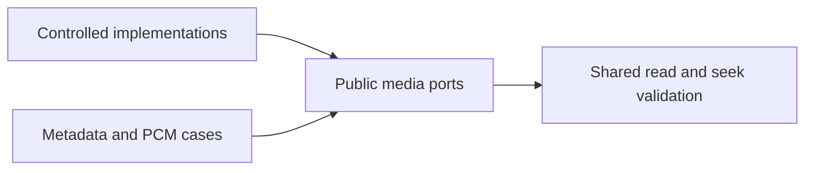

# Media contract tests

All five targets link `wiola::media` directly, without the checkout-wide `wiola_core` include path. No production driver, filesystem fixture, output device or Qt service is part of their dependency closure.

`decoder_contract_test.cpp` checks alignment, exact/estimated/unknown lengths, progress, explicit EOF, transactional seeking and typed errors. `decoder_port_test.cpp` destroys an asset before using its owned decoder, then reads and seeks through the public interface.

`track_metadata_test.cpp` checks independent metadata fields and emptiness. `metadata_writer_test.cpp` checks field-edit requests and the read-only asset default. `stream_spec_test.cpp` checks frame/sample/time conversion, overflow and channel-layout admission. These are relocated existing cases with unchanged semantic names and target identities.

Configure with `-DWIOLA_COMPONENTS=media` and build the local targets declared in `CMakeLists.txt`. Ordinary player builds compose these same targets. `media_byte_stream_test` remains a separate mixed native-file/stream integration suite until its concrete I/O fixture is separated.

The installed-consumer case is registered in this directory's `CMakeLists.txt`. CMake installs and relocates the package, compiles every actual installed header independently, and links the C++ consumer. Native consumers also run; cross consumers only link. Each run retains compiler/test logs in its own `Testing/PublicPackage-*` directory under the configured build. No Python checker or JSON header manifest is involved.
