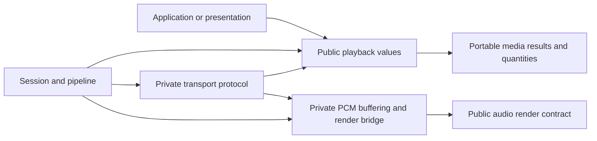

# Playback contracts and buffering

This component owns portable playback values, buffering, decoder loading, queue policy and the complete private transport protocol. Session/pipeline services still consume these targets from `src/engine`; their public facade has not completed its export yet.

Link `wiola::playback_api` for `<wiola/playback/...>`. It exposes playback state, open status, asynchronous outcomes, snapshots and queue occurrence IDs together. It imports no transport class, atomics, output driver or application implementation. Installed consumers use `find_package(wiola_playback CONFIG REQUIRED)`.

`PlaybackState` describes transport intent/terminal outcome rather than an output device's observation. A snapshot owns its resource path and optional duration; unknown duration is distinct from known zero. Structural, metadata and selection revisions remain separate. Snapshots do not retain a worker or borrow Session state.

Receipts distinguish acceptance from completion. Correlate outcomes by operation kind and ID; zero denotes no asynchronous completion. A batch owns its result/diagnostic data, and `overflowed` means older results were discarded. Queue occurrence IDs are separate from row position and reserve zero for unassigned entries. These values create no scheduler, registry or universal command bus.

`wiola_playback_buffer` is an internal source-build target with a scoped `private/` include root. The complete [buffering implementation](private/buffering/README.md) and [tests](tests/buffering/README.md) stay together. `BufferSource` adapts that queue to the public audio `Source`; portable audio processing never depends on playback storage.

`wiola_playback_transport` is an internal source-build target for the complete [transport protocol](private/transport/README.md): state arbitration, player commands, worker, decode loop, playhead, seek transaction/mailbox and epoch. It depends on public media/output contracts and private buffering; it imports no DSP, Qt, codec or global source-root target. Its [tests](tests/transport/README.md) use controlled PCM sources; a real decoder-to-player journey remains with codec integration tests.

`wiola_playback_loading` owns the [decoder load lifecycle](private/loading/README.md) and [tests](tests/loading/README.md): bounded physical opening/cancellation and exact logical request acceptance. Metadata inspection has its own consumer-owned worker port and applicability policy.

`wiola_playback_queue` owns [queue ordering/identity/metadata invariants](private/queue/README.md) and [focused tests](tests/queue/README.md), independent of transport and metadata worker scheduling.

`wiola_playback_metadata` owns [metadata inspection policy and bounded work](private/metadata/README.md), with [tests](tests/metadata/README.md) that substitute controlled delivery without running the physical reader. Decoder loading and queue metadata inspection retain distinct lifetimes.

Configure the currently owned closure with `-DWIOLA_COMPONENTS=playback`, without Qt/FFmpeg/miniaudio. [Contract tests](tests/README.md) also verify the relocated installed API independently of buffering and the current legacy engine.
