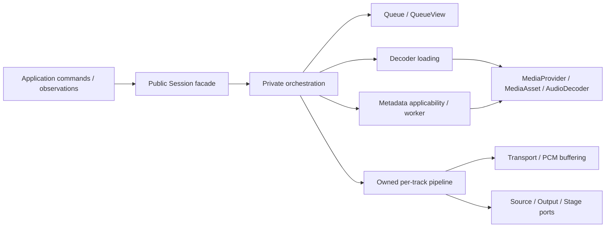

# Playback kernel

This component owns Session, queue observations, decoder loading, metadata applicability, buffering and transport. The application supplies media, output construction and processing through public C++ ports. Built-in equalizer/volume composition belongs to the application; the kernel requires no DSP archive, Qt, FFmpeg or miniaudio.

Link `wiola::playback` and include `<wiola/playback/session.hpp>` for the complete kernel. Session's opaque implementation owns its workers, queue, outcomes and active pipeline; private edits stay outside application/frontend headers. The always-present Loader is a direct member. TransportConfig and BufferingConfig are independent immutable per-instance policies; invalid configuration or a null provider fails before work starts.

`wiola::playback_api` supplies portable state, typed outcomes, snapshots, repeat mode, queue identity and read-only observations. These values can be consumed without the runtime archive. A snapshot owns its path and optional duration; unknown duration differs from known zero. QueueEntry copies own path/metadata and share only immutable artwork. QueueView is a live read port on the owning control thread: reacquire borrowed spans/pointers after any mutation attempt, including failed reserve. Structural, metadata and selection revisions retain distinct roles.

One control thread issues commands, collects completions and installs prepared resources. Blocking decoder/metadata work runs on owned workers. Output callbacks use bounded Source/Stage operations without allocation, I/O or waiting for control work. The supplied Stage outlives Session and its outputs; sharing it requires an implementation that supports that concurrency. Prepare may coexist with old callbacks; commit and destruction occur on the control thread after callbacks quiesce.

Opening distinguishes acceptance, successful installation and eventual device-start failure. The kernel prepares processing, output lease, queue/player and owned path before retiring active playback. Its last fallible step retains the completion; activation/swaps then cannot fail or allocate. A failed candidate preserves the prior pipeline without rewinding its source. OperationError keeps media failure separate from output setup failure, including diagnostics. Outcome batches own their values and report retention overflow.

The kernel exposes play/pause/resume, queue operations and occurrence/generation-checked release/restore handoffs. Application toggle policy composes those commands. Changes to intent or position during a handoff remain owned by Session; stale restoration cannot replace a newer occurrence.

Implementation and focused tests have one owner:

| Mechanism | Code and invariant guide | Tests |
| --- | --- | --- |
| PCM queue and callback source bridges | [buffering](private/buffering/README.md) | [buffering cases](tests/buffering/README.md) |
| Transport, state and seek protocol | [transport](private/transport/README.md) | [transport cases](tests/transport/README.md) |
| Decoder request/cancellation lifecycle | [loading](private/loading/README.md) | [loading cases](tests/loading/README.md) |
| Queue identity, ordering and metadata | [queue](private/queue/README.md) | [queue cases](tests/queue/README.md) |
| Metadata applicability and bounded work | [metadata](private/metadata/README.md) | [metadata cases](tests/metadata/README.md) |
| Per-track bundle and reusable output lifetime | [pipeline](private/pipeline/README.md) | [pipeline cases](tests/pipeline/README.md) |

Configure with `-DWIOLA_COMPONENTS=playback` to build this closure without backend/frontend SDK discovery. Session unit tests supply decoded-stream facts through MediaProvider; real encoded-media journeys belong to codec integration. [Tests](tests/README.md) use ordinary CTest and relocated installed consumers.

Installed clients use `find_package(wiola_playback CONFIG REQUIRED COMPONENTS runtime)` and `wiola::playback`. The `wiola_playback` install component owns headers/API metadata; `wiola_playback_runtime` adds the compiled closure. A values-only installation supports `COMPONENTS api` and `wiola::playback_api` without the audio/worker runtime dependencies. Static implementation archives are exported for linking, while implementation headers and checkout include roots remain private.
