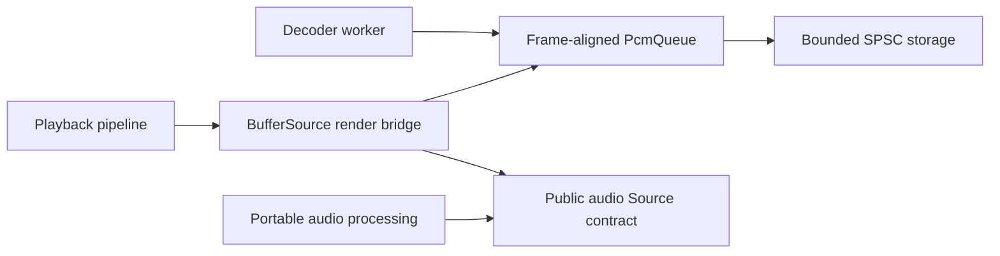

# Playback implementation

The transport buffer and queue-to-render bridge live here as one owned mechanism. Session/load/transport coordination currently consumes this target from `src/engine`; those services have not yet completed their public component extraction.

`wiola_playback_buffer` is an internal source-build target. Its scoped `private/` include root makes buffering available to playback implementation and its tests, not as an installed player API. It depends only on public media, audio and ownership contracts. Audio processing never depends on playback or the queue; `BufferSource` belongs with the queue it adapts.

The complete [buffering implementation](private/buffering/README.md) and [focused tests](tests/buffering/README.md) live in this subtree. There are no parallel PCM/lock-free/cache-line helper owners.
