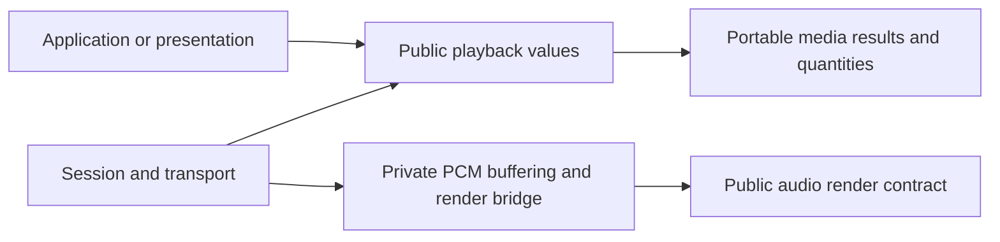

# Playback contracts and buffering

This component owns portable playback values and the private transport-buffer mechanism. Session/load/transport coordination currently consumes these targets from `src/engine`; those services have not completed their public export yet.

Link `wiola::playback_api` for `<wiola/playback/...>`. It exposes playback state, open status, asynchronous outcomes, snapshots and queue occurrence IDs together. It imports no transport class, atomics, output driver or application implementation. Installed consumers use `find_package(wiola_playback CONFIG REQUIRED)`.

`PlaybackState` describes transport intent/terminal outcome rather than an output device's observation. A snapshot owns its resource path and optional duration; unknown duration is distinct from known zero. Structural, metadata and selection revisions remain separate. Snapshots do not retain a worker or borrow Session state.

Receipts distinguish acceptance from completion. Correlate outcomes by operation kind and ID; zero denotes no asynchronous completion. A batch owns its result/diagnostic data, and `overflowed` means older results were discarded. Queue occurrence IDs are separate from row position and reserve zero for unassigned entries. These values create no scheduler, registry or universal command bus.

`wiola_playback_buffer` is an internal source-build target with a scoped `private/` include root. The complete [buffering implementation](private/buffering/README.md) and [tests](tests/buffering/README.md) stay together. `BufferSource` adapts that queue to the public audio `Source`; portable audio processing never depends on playback storage.

Configure the currently owned closure with `-DWIOLA_COMPONENTS=playback`, without Qt/FFmpeg/miniaudio. [Contract tests](tests/README.md) also verify the relocated installed API independently of buffering and the current legacy engine.
