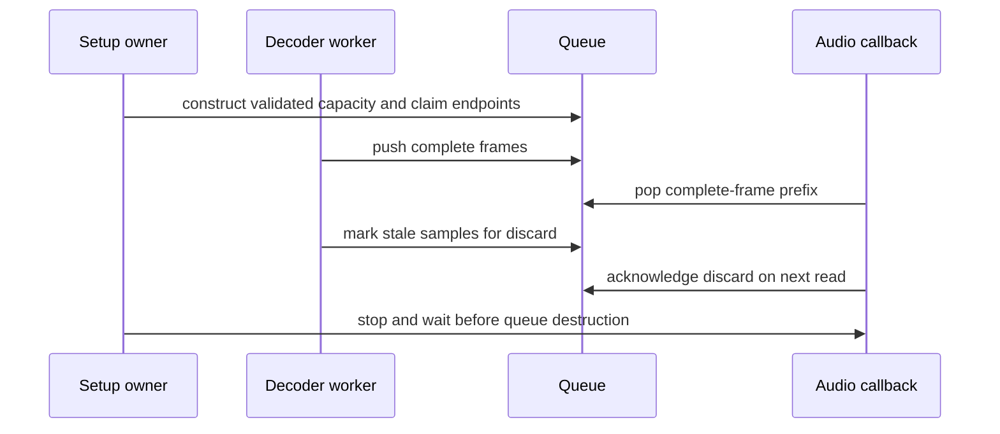

# PCM transport buffering

`PcmQueue` aligns PCM samples to complete frames, using `SPSCRingBuffer` for bounded storage. `BufferSource` adapts its consumer to the public `Source` render contract. Cache-line separation is private to this mechanism; PCM shape and frame/time values come from the media API.

Claim producer and consumer endpoints once on the setup thread before worker execution. Claims themselves are not concurrent operations. The queue outlives both endpoints; moving an endpoint leaves its previous holder inert. Each running endpoint owns its index, with release/acquire publication to the other thread. Observer counts are approximate and cannot establish transaction ordering.

Capacity rounds to a power of two with a minimum of two elements, including a zero minimum request. Unrepresentable rounding throws before `bit_ceil` or allocation. PCM construction validates stream shape and frame-to-sample conversion first; unused trailing samples never form a partial frame. Allocation happens at construction, never in push/pop/render.

An acquired region remains valid until its matching commit. Do not acquire again or use a copying operation on that endpoint before committing. Discard is producer-marked and consumer-acknowledged; it does not invalidate a read region already handed out. Stop/quiesce participants before releasing storage or performing external pipeline replacement. There is no concurrent reset operation.

All memory-ordering, capacity and endpoint rules are implemented here. Existing class namespaces are preserved while consumers move to this owner. The files are implementation details, not another public plugin API.
