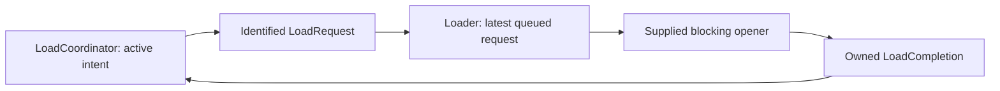

# Decoder loading

This owner contains the complete decoder-open worker, request/completion values and single-caller acceptance policy. It depends on public media and playback identity contracts, without Qt, codec SDKs, queue implementation or transport. Host composition supplies the provider/opener.

Loader has at most one active open, one queued replacement and one unclaimed completion. Start/cancel/take and destruction belong to one lifecycle caller. The worker alone invokes the opener. A generation maintained by the worker rejects obsolete physical completions, while LoadCoordinator accepts an exact active logical request at most once; duplicate resource paths or queue occurrences do not identify the same intent.

Each active open gets a fresh cancellation source. Start and cancel capture the obsolete source under the mutex, then request cancellation after releasing it: stop callbacks execute synchronously and may query worker state. Retired decoders are moved out under the mutex and destroyed after unlock. Opener calls and stale-result destruction also stay outside the mutex. No collaborator code runs while it holds the state lock.

Cancel drops queued and unclaimed work, rejects a later active completion and cooperatively stops the active opener. It cannot forcibly interrupt an opener that ignores its context. A decoder already handed over retains its context; later requests and loader destruction do not cancel that decoder. Destruction cancels pending work, stops the worker and joins it before the provider/opener can die.

Normal opener exceptions become unreadable completions; allocation failure retains the existing fatal policy. Thread launch occurs before publishing a request so launch failure cannot leave an accepted request permanently busy. The logical coordinator does not hide physical I/O cancellation; Session invokes both when clearing/stopping/removing an active request or releasing media.

The provider adapter forwards an open error unchanged and uses the same active operation context for opening the asset and creating its decoder. A successful result containing no asset is a damaged completion, never a null dereference or a stuck worker. A subsequent request can still succeed. Decoder validation and output installation remain Session's responsibility.
