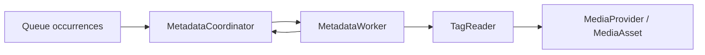

# Queue metadata inspection

MetadataCoordinator owns generation/occurrence acceptance, coalescing and deferred submission. MetadataWorker is its narrow work port, with owned request/result values and prefix acceptance. TagReader implements bounded blocking reads on one worker. These responsibilities share this owner without importing decoder/output state, Qt or codec SDKs; the host supplies a non-null MediaProvider.

The worker echoes generation, representative occurrence and resource identity. Coordinator accepts only the current generation and exact requested representative for that path; duplicate queue occurrences stay distinct in the coalesced result. A late result for the same resource cannot be reassigned to a replacement occurrence. The worker is declared last so it stops/joins before policy state is destroyed.

TagReader bounds pending requests, completed result count and completed artwork bytes. Each active request has its own cancellation source/generation; there is no shared batch stop state. Lifecycle submission/cancellation/collection have one caller, while the worker performs blocking reads. Cancellation captures only an older active context under the mutex and invokes stop callbacks after unlocking. Shutdown stops new claims before capturing/cancelling the current context and joining.

Completion backpressure wakes for capacity, worker shutdown or generation obsolescence. Generation is checked again after waking, before publication; cancellation can therefore retire obsolete work while newer completed results still fill the budget. Metadata values own their payloads. Normal reader exceptions preserve typed failures or become unreadable results; allocation failure retains its fatal policy. A collaborator that ignores cancellation still has to return before destruction can join it.

TagReader owns its provider reference directly. It preserves opening errors and rejects a successful null asset as damaged metadata. It forwards the active operation context to the returned asset, including cancellation accepted while the provider was still opening it. Metadata failure never constructs a decoder or changes playback state. Unit tests supply the same provider/asset contract as drivers; there is no alternate callable I/O constructor to maintain when that contract changes.
