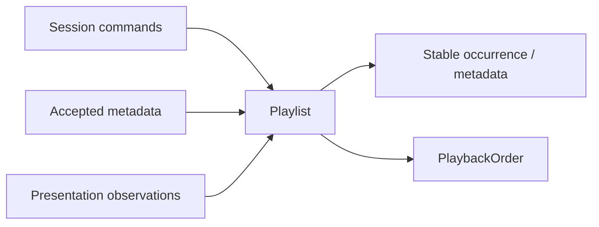

# Playback queue

Playlist owns queue occurrences, indexed metadata and separate structural/metadata/selection revisions. Track owns immutable occurrence identity/location and its learned metadata values. PlaybackOrder owns permutation, repeat policy and the current position. These classes share one queue invariant and live together; none opens files, decodes, starts a worker or touches a device/frontend.

A queue occurrence is not its resource path or row index. Replacement allocates new identities; duplicates remain distinct. Metadata lookup uses occurrence identity, and unrelated revisions remain independent. Set/append prepare their fallible state before committing so an allocation failure preserves the accepted queue and current selection.

The scoped internal target imports public media/playback values only. It has no transport, worker, DSP, codec, Qt or global source-root dependency. Existing Session/presentation headers still name these types until facade/presentation isolation is completed; they declare that real dependency directly. Queue implementation headers are not installed as public playback API.
