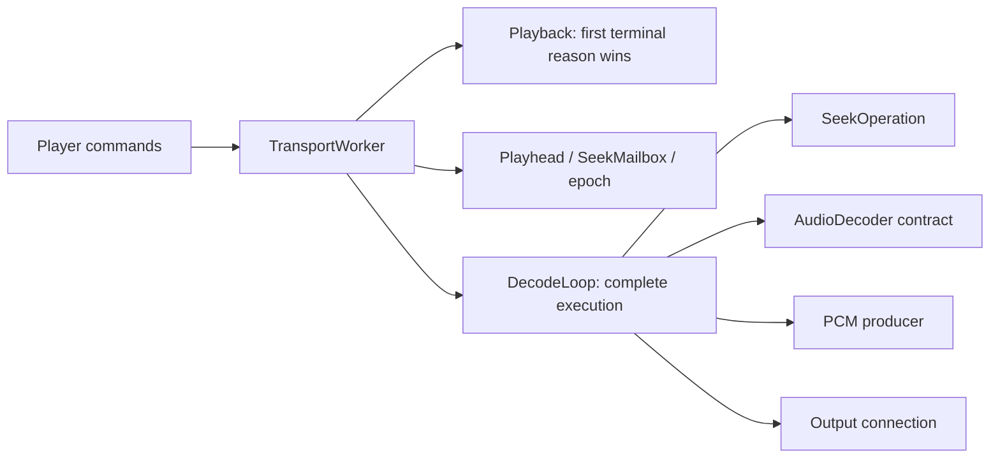

# Playback transport

This private owner keeps one decoder feeding one output. No codec, device SDK, Qt, DSP or application type enters this target. `Player` translates time commands, `TransportWorker` owns the thread, and `DecodeLoop` owns its complete execution and output cleanup. Buffering stays with the adjoining playback mechanism.

Start/restart and joining belong to one lifecycle owner. Pause/resume/stop/seek update synchronized state and wake the worker rather than performing decoder/device I/O. Requested playing state is distinct from observed output running state. The first terminal state remains settled until a new start; EOF or fault cannot replace an accepted stop.

Only the worker seeks, reads, primes or starts/stops output. `DecodeLoop::run` catches unexpected collaborator exceptions, settles `faulted`, and quiesces output on every exit. Already accepted terminal reasons remain authoritative. The worker joins before decoder/connection destruction; the borrowed output and queue outlive the player.

`Playhead` has one movable applier. Its mailbox serializes requests, claims and position/epoch observations; submitted frames are worker-owned. `SeekOperation` quiesces output, changes the decoder, acknowledges an achieved position and primes the new epoch. Failures retain the actual decoder position rather than publishing an unachieved request.

The target's build-only include root exposes `<transport/...>` to internal playback clients. These implementation headers are not installed. Application clients consume the public playback values and existing Session facade; the remaining Session/load/pipeline relocation is separate work.

Seek startup and active requests use the same transaction. Its returned outcome distinguishes applied position, preserved cursor, read failure, cancellation and supersession; there is no mutable failure flag for a caller to remember to inspect. The decoder validates its own exact/approximate length rules. A no-request apply leaves output and queued audio alone.

A completed blocking seek acknowledges its actual decoder position, retiring only the claimed generation. Priming checks terminal state and newer requests before reading and again before submitting a completed block. Output stays quiesced until the decode loop has rechecked the mailbox; a superseded epoch is never restarted between requests. A stop before execution preserves the pending request without performing I/O. A stop during execution prevents further priming and output restart. Blocking collaborators still need to honor their own cancellation contract; this protocol cannot forcibly interrupt arbitrary backend calls.
