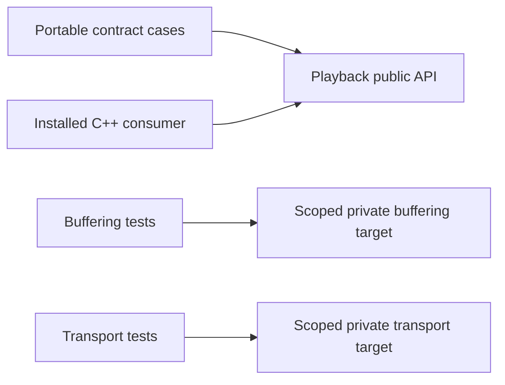

# Playback contracts

`playback_contract_test` links only `wiola::playback_api`, GoogleTest and selected instrumentation. It verifies media-to-open-status translation and occurrence identity behavior. Existing Session, Playlist and presentation suites continue to verify outcome correlation, retention, revisions and actual snapshot production through their service APIs.

`Playback.InstalledConsumer` uses ordinary CMake to install/relocate the package, compile every actual installed header independently and link `consumer.cpp`. Only media/quantities packages are installed with it; audio, devices, transport, worker and GUI libraries are unnecessary. Native consumers run, while cross consumers compile/link only. There is no header manifest or Python checker.

[Buffering tests](buffering/README.md) cover the separate private queue/render mechanism. No standalone operations or snapshot module remains.

[Transport tests](transport/README.md) cover state, playhead, worker failures and player commands without a codec, filesystem or output SDK. A real FFmpeg-to-player integration journey remains in `tests/codec/player_integration_test.cpp`.

[Loading tests](loading/README.md) independently qualify request identity, cooperative cancellation, decoder lifetime, external callbacks outside locks and late completion rejection.
