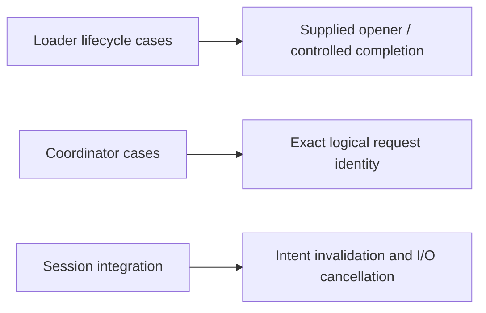

# Decoder loading tests

`engine_loader_test` uses supplied C++ openers and controlled gates to check completion ownership, replacement/cancellation, exceptions, shutdown and context lifetime. Stop callbacks and retired decoder destructors query Loader state, so invoking them under its mutex deadlocks the actual regression rather than merely checking a counter. No fixture opens a file or imports a codec/Qt/device SDK.

Provider-boundary cases supply public MediaProvider/MediaAsset collaborators through the shared C++ fake. They check successful-null asset rejection and recovery, preservation of backend errors, and one active cancellation context across asset opening and decoder creation. Existing fatal-allocation subprocess tests retain their native LLVM profile limitations; a passing fatal policy is not reported as a flushed child profile.

`engine_load_coordinator_test` checks exact generation/occurrence/resource/intent matching, at-most-once acceptance, supersession and invalidation. It does not implement another scheduler or duplicate the worker mechanism. Session integration tests check that stop, clear and empty queue replacement reject late installation and propagate cancellation to the supplied opener.

Build these focused targets with `WIOLA_COMPONENTS=playback` for the portable dependency closure. Run affected cases through ordinary CTest and native sanitizers. Coverage uses ordinary LLVM output; no source/test ownership manifest is required.
