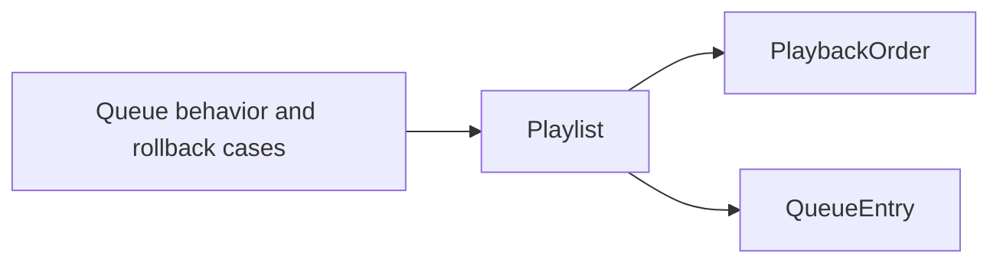

# Queue policy tests

`engine_playlist_test` checks ordering, repeat/shuffle behavior, stable duplicate occurrence identity, metadata lookup/revisions, current selection and rollback under allocation failure. It links only the private queue target and GoogleTest; no assembled engine, codec, Qt, device or worker is required.

The shared C++ allocation-failure witness in `tests/support` replaces standard unaligned C++ allocation/deallocation functions for this executable, without naming platform ABI symbols or requiring linker wrapping. It does not affect production allocation or introduce a process-wide player service. Run the selected target with ordinary CTest; configure `WIOLA_COMPONENTS=playback` to verify the portable closure independently.

`AllocationFailure` owns a thread-local scope and restores the previous limit. Replacement allocation/deallocation functions are isolated in its translation unit. TSan supplies strong allocation replacements, so its normal queue cases run without this witness; rollback cases fail each allocation in turn until successful replacement, append or metadata application, without fixed allocation-count assumptions. They run in Debug/ASan and portable Windows compilation. Metadata rollback checks every occurrence's facts, artwork and revision as well as queue revisions and selection. Missing titles retain each occurrence's own fallback.

Focused observation cases cover no-op/obsolete metadata preserving revisions, artwork replacement preserving selection, repeat choice across empty replacement, and empty/order-invalid mutations. The original metadata assertions now use the canonical immutable metadata value.

The live read-port case retains an owned observation while the actual queue changes metadata, appends, removes and clears. Each fresh span/identity lookup reflects the accepted owner state; retained facts and selection semantics remain independent.
