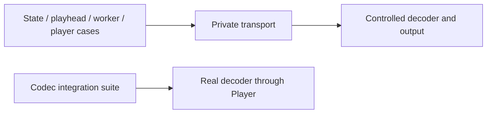

# Transport contracts

The four focused executables cover Playback state arbitration, Playhead claims/epochs, TransportWorker lifecycle/failures and Player commands. They link the private transport target and controlled C++ collaborators, with no codec, filesystem, Qt or device SDK. `rig.hpp` belongs here because it only assembles the player, PCM queue and fake output used by these tests. Its small callback gate holds device progress until a test calls `play_out`; `hold_output` can hold a replay after the previous execution is joined. Intermediate state assertions do not race automatic exhaustion.

Player's ordinary source is generated PCM with an explicit stream shape and duration longer than the priming buffer. Tests that need unusual reads, unknown length, blocked seeks or failures supply their own decoder. Seek movement waits for the worker to apply its request and restart output before releasing device progress, then asserts the achieved request and consumed frame count. Stop checks quiescence and an undrained source instead of a wall-clock threshold; final position equals the controlled source duration. The real FFmpeg decoder-to-player journey stays in the codec integration suite instead of making transport unit tests prepare WAV files.

New worker failure cases use a gate to order stop/seek against a decoder failure. Existing broader player integration-style cases retain progress polling and are not claimed as deterministic scheduler proofs. Native TSan exercises actual threads; state/ownership tests assert outcomes independently of sanitizer diagnostics.

Configure `WIOLA_COMPONENTS=playback` to run this owner with the portable media/audio/buffering closure alone. Public package consumers remain separate and install no transport implementation headers.
