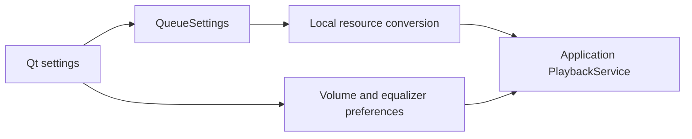

# Qt playback preferences

This owner binds application volume, equalizer and queue state to Qt settings. It does not construct a second playback kernel or own decoder state. PlaybackPreferences coordinates QueueSettings, VolumeControl and EqualizerControl for the supplied PlaybackService.

The existing queue-settings schema stores native file paths and queue occurrence IDs. Restore checks the saved files and composes local resource references. Save converts only references owned by the local provider; other providers' keys are never interpreted or persisted as filenames. Durable persistence for non-local resources is outside this schema's contract.

Duplicate files retain distinct occurrence IDs and selection remapping. An unavailable file is omitted without selecting another duplicate by its name. GUI lifecycle/restoration stays outside the portable Session, so recreating a window does not create or restore another playback queue.
