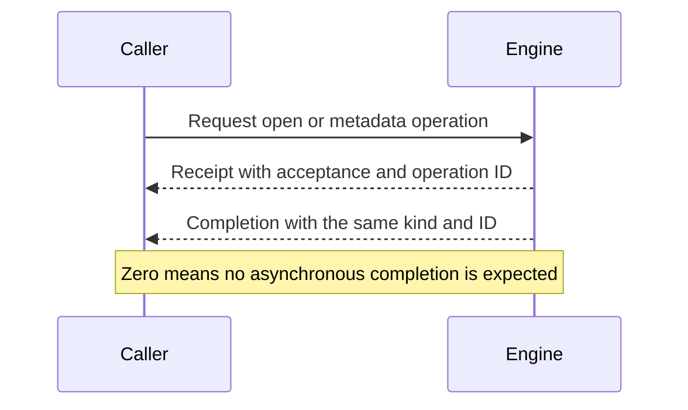

# Engine operations

This folder owns the engine's asynchronous operation vocabulary: identity, immediate acceptance, eventual completion and bounded completion batches. Link `wiola::engine_operations` and include `<engine/operations/operation_outcome.hpp>`. Values remain in `wiola::engine`; no application or GUI type is involved.

The engine generates IDs; consumers correlate kind and ID rather than assuming completion order. A receipt distinguishes acceptance from successful completion. Each outcome owns its media result and diagnostic text. `OperationOutcomes::overflowed` says older values were discarded, so a returned batch must not be treated as complete history. These values create no worker, callback, synchronization or shared lifetime.

The header, target and guide live here. Session owns completion production and bounded retention; application services consume this vocabulary. Replace either side while preserving correlation, acceptance and overflow semantics. Existing session and playback-service tests exercise that behavior.

The target currently obtains the portable `media::Result` header through legacy `wiola_core`. Its broad source-root export remains explicit migration debt for the later public-dependency cleanup. Stable ownership IDs retain their historical `source.app.playback` spelling so source/coverage moves preserve measurement identity; they do not imply application ownership. The former application header is removed.
