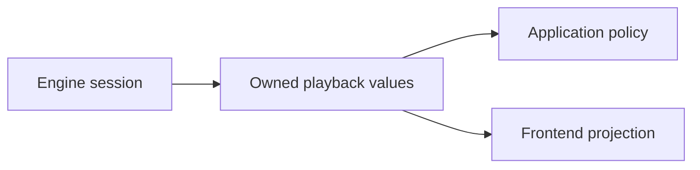

# Playback snapshot

This folder owns `wiola::engine::PlaybackSnapshot`, the value returned by the engine to describe one coherent playback observation. Link `wiola::engine_playback_snapshot` and include `<engine/playback_snapshot/playback_snapshot.hpp>`.

The snapshot owns its track path, optional queue position, revisions and time values. Copying or retaining it does not borrow session state or extend a worker/device lifetime. Structural, metadata and selection revisions remain separate signals. Loading/open status, transport state, loaded/playing flags and seekability retain their existing meanings; an absent duration is not a known zero duration. This value starts no playback and selects no decoder, device or GUI.

The header, target and guide live together. Session produces snapshots; application presentation consumes them. Existing session, playback-service and playback-presentation tests check their behavior. Changes must preserve those observable semantics and stay independent of application and GUI headers.

The target currently uses portable engine transport/open-status and units declarations through legacy `wiola_core`; its broad export remains debt for the public-dependency cleanup. Open status directly includes the media error vocabulary, without importing the unrelated media facade. The historical owner ID is retained for coverage lineage. There is no forwarding header under application playback.
