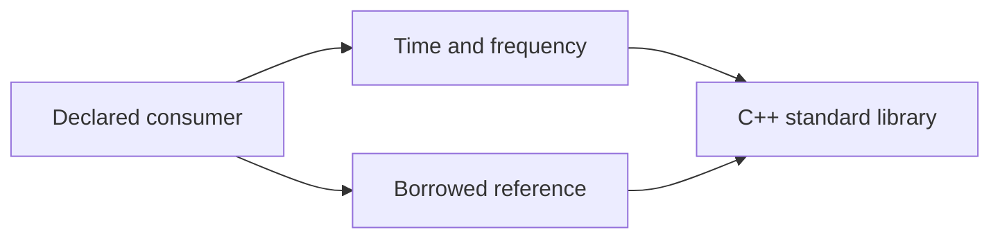

# Foundation

This grouping contains standard C++ primitives with independent header-only targets. Each owner contains its complete headers, tests and export definition. Borrowed capabilities and dimensional quantities are separate contracts; neither depends on player policy, a toolkit or a backend. Source headers sit directly in their owning directory. CMake preserves namespaced SDK includes without repeating that namespace as source directories.

[Borrowed references and handles](borrowed_reference/README.md) own borrowed storage, exclusive capability transfer, focused tests and one export definition. No foundation implementation selects a GUI, media backend or application policy.

[Quantities](quantities/README.md) owns time/frequency values and a standard-only public target. Related values stay together; no unit tag is an independent component.
