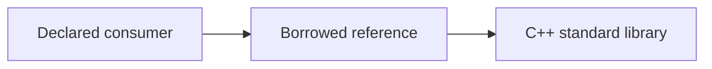

# Foundation

This grouping contains toolkit-independent primitives with their own restricted exports. The remaining legacy primitives still live under `core`, `utils` and `lockfree`; this folder does not imply that migration is finished.

[Borrowed reference](borrowed_reference/README.md) owns its public template, tests and export definition. No foundation implementation selects a GUI, media backend or application policy.
