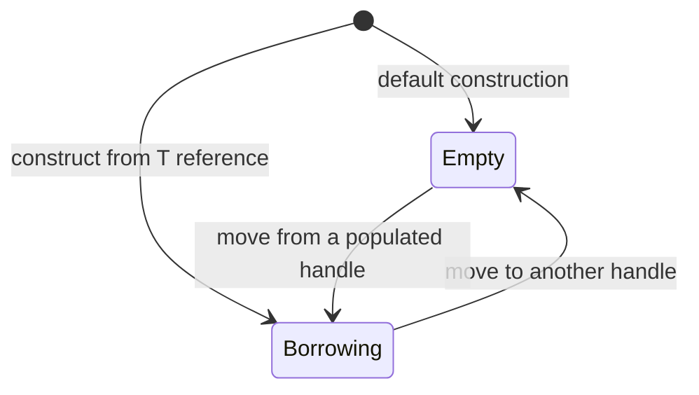

# Borrowed references and exclusive handles

This component owns move-only borrowed storage and the exclusive capabilities built on it. `wiola::core::Borrowed<T>` is a nullable pointer to an object owned elsewhere. `Handle<Owner>` transfers a borrowed capability, and `Claimable` records whether its owner has handed that capability out. Their complete templates, public export and tests live together; these related pieces share one target. Namespaces and existing class identities are retained.

Moving clears the source; copying is forbidden. Dereference requires a nonempty handle and a live external owner. Destruction never destroys the referent. This value has no synchronization and does not extend object lifetime; cross-thread transfer requires the containing protocol's synchronization.

Claim/release operations belong to the setup/owner thread and are not atomic. Moving a handle clears its previous holder; claiming again while it is held returns an inert capability. A concrete handle defines its own forwarding and release behavior. The referent must outlive every handle; no operation acquires shared lifetime or provides worker synchronization.

Link `wiola::borrowed_reference` and include `<wiola/foundation/borrowed.hpp>` or `<wiola/foundation/handle.hpp>`. The authored headers are [borrowed.hpp](borrowed.hpp) and [handle.hpp](handle.hpp), beside the component's build definition and tests. Both are self-contained and require only standard C++23. CMake exports these two headers explicitly; implementation helpers, test support and checkout include roots are excluded from installation. Installed clients use `find_package(wiola_borrowed_reference CONFIG REQUIRED)`.

[Tests](tests/README.md) verify transfer, aliasing and a relocated installed consumer. Keep helpers in this owner and publish a header only when it belongs to the supported lifetime contract.
