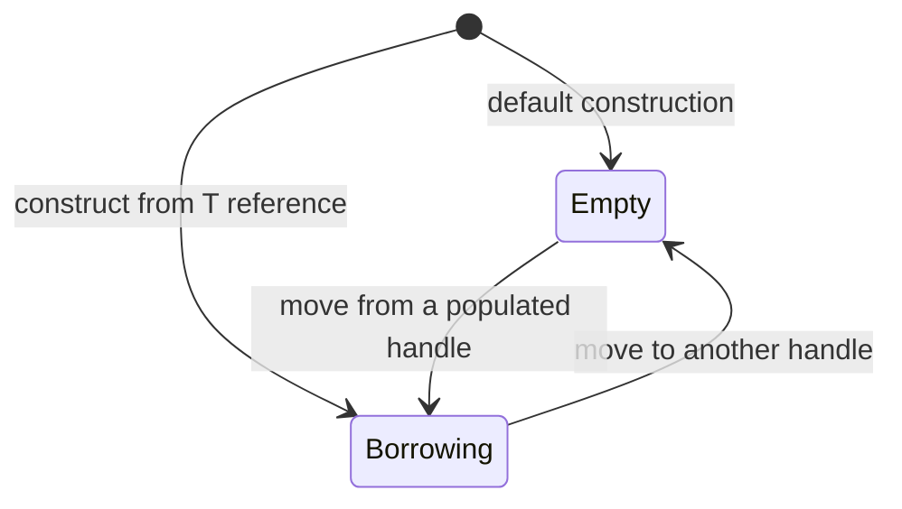

# Borrowed reference

`wiola::core::Borrowed<T>` is a move-only, nullable pointer to an object owned elsewhere. Its complete template, public export and contract tests live here. The namespace is retained for source compatibility; the old `core/borrowed.hpp` header is removed.

Moving clears the source; copying is forbidden. Dereference requires a nonempty handle and a live external owner. Destruction never destroys the referent. This value has no synchronization and does not extend object lifetime; cross-thread transfer requires the containing protocol's synchronization.

Link `wiola::borrowed_reference` and include `<wiola/foundation/borrowed.hpp>`. Only `public/` is exported; the target does not expose the checkout root or depend on `wiola_core`. The same target can be loaded with `find_package(wiola_borrowed_reference CONFIG REQUIRED)` after installation. Existing aggregate consumers temporarily receive this declared target through `wiola_core`; its remaining broad exports are still migration debt.

[Tests](tests/README.md) verify transfer/aliasing and a relocated installed consumer. Add private helpers inside this owner, outside `public/`, and keep changes compatible with these lifetime guarantees.
