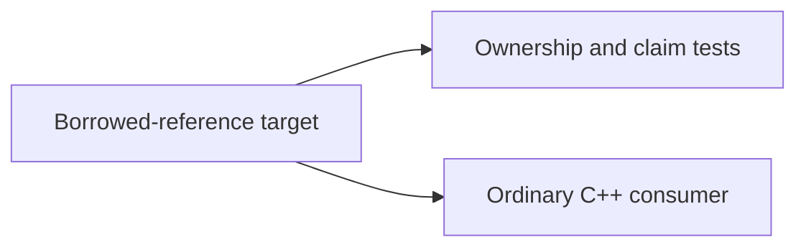

# Borrowed-reference contracts

`borrowed_reference_test.cpp` verifies move-only transfer, source clearing, nullable state and aliasing. `handle_test.cpp` verifies exclusive claims, moves, returning capabilities and inert-handle destruction. The focused targets link only the borrowed-reference API, GoogleTest where needed and the selected build controls.

Configure with `-DWIOLA_COMPONENTS=borrowed_reference`. `BorrowedReference.Consumer` builds `consumer.cpp` against `wiola::borrowed_reference` and runs directly through CTest. No installation or separate consumer project is needed.
