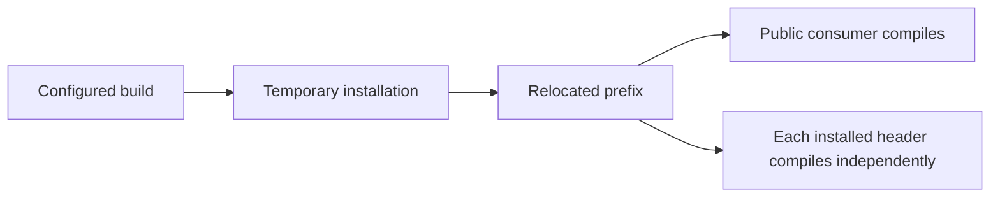

# Borrowed-reference contracts

`borrowed_reference_test.cpp` verifies move-only transfer, source clearing, nullable state and aliasing without Qt or GTest. `consumer.cpp` compiles against only the installed export. The local CMake test installs and relocates the package, compiles and links the consumer, and compiles each actual installed header independently. It requires no Python runner or header manifest.

Run CTest cases `BorrowedReference.OwnershipTransfer` and `BorrowedReference.InstalledConsumer`. The consumer check uses the configured compiler, target system and optional toolchain. Native consumers run; cross consumers link without running the target executable. Each run uses a separate CMake consumer project and retains compiler/test logs under the configured build's `Testing/PublicPackage-*` directory.
