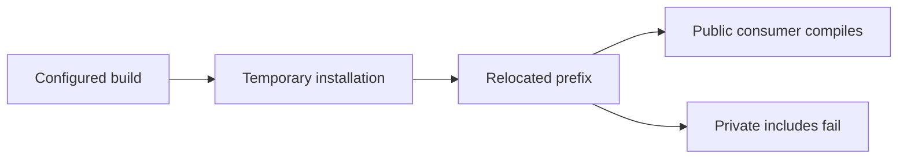

# Borrowed-reference contracts

`borrowed_reference_test.cpp` verifies move-only transfer, source clearing, nullable state and aliasing without Qt or GTest. `consumer.cpp` compiles against only the installed export. `public_package.json` supplies local probe facts to the shared `scripts.testing.public_api` checker, which installs and relocates the package, compiles/links the public consumer, compiles its header independently and precisely rejects legacy/private includes.

Run CTest cases `BorrowedReference.OwnershipTransfer` and `BorrowedReference.InstalledConsumer`. The consumer check uses the configured compiler, target system and optional toolchain. Native consumers run; cross consumers link without running the target executable. Temporary workspaces are isolated outside the checkout and removed on exit; phase logs remain in the configured build evidence directory.
