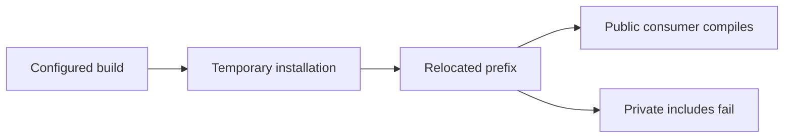

# Borrowed-reference contracts

`borrowed_reference_test.cpp` verifies move-only transfer, source clearing, nullable state and aliasing without Qt or GTest. `consumer.cpp` compiles against only the installed export. `check_export.py` installs the header component into a temporary prefix, relocates it, compiles the public API and requires compilation to reject both a legacy checkout header and this owner's private probe header.

Run CTest cases `BorrowedReference.OwnershipTransfer` and `BorrowedReference.InstalledConsumer`. The consumer check uses the configured compiler and target system; it never runs a cross-compiled executable. Temporary directories are isolated and removed on exit.
