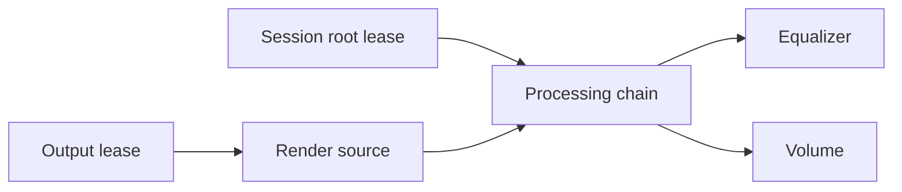

# Typed lifetime graph

`Lease<T>` is a non-null shared ownership node. `make` owns a leaf; `dependent` creates a new object from an owning factory and leases of its existing dependencies. The factory receives references to those inputs, and the new node retains their owners until after its own object is destroyed. Dependencies are established at construction and are not rewired through this API. This makes construction order describe a directed acyclic lifetime graph.

Leases cannot be default/null constructed or created from a borrowed pointer/shared-pointer alias. Copies are non-throwing and remain valid even when copied from rvalues. Represent absence with `optional<Lease<T>>`. `member<&T::field>()` retains the parent when observing a direct data member and preserves constness; member functions cannot manufacture unowned reference views. Direct access requires a named lvalue lease. `WeakLease::lock()` obtains a real ownership lease before exposing an object.

Factories return unique ownership. Concrete deleters are preserved through interface views; dependencies are released after the dependent object, including during exceptional construction. Factories still own the correctness of references they capture from outside the declared graph. Object access and mutable state require their own synchronization. Graph construction, ownership changes and last-owner destruction belong outside real-time callbacks; rendering uses prebound references backed by retained nodes.

`LeaseHandle<T>` transfers a move-only capability while retaining its owner. Derived ports supply exclusive claim/release policy. Moving empties the source; `retain_owner()` keeps an active call valid through reentrant handle disposal. Clearing publishes the inert state before retiring ownership.

Include `<wiola/foundation/lease.hpp>` / `<wiola/foundation/lease_handle.hpp>` and link `wiola::lifetime`. Configure `-DWIOLA_COMPONENTS=lifetime -DENABLE_UNIT_TESTS=OFF` to build and run the standard-only consumer without SDK or GoogleTest downloads. Implementation, contracts and ordinary consumer tests stay in this owner.
